# Chapitre 1 — Virtualisation
*D'après le cours de Dr Afef Bohli & Dr Naourez Mejri*

---

## PARTIE 1 : Introduction et contexte historique

**Origine du terme** : le mot "virtualisation" vient des **mainframes des années 60**, où il désignait une méthode de division logique des ressources d'un mainframe pour plusieurs applications.

### Étape 1 — Système centralisé (1960-1970)
- Un seul processeur → horloge commune
- Une seule mémoire centrale → espace d'adressage commun
- Un seul OS → gestion centralisée des ressources
- Accès local aux ressources, peu d'utilisateurs

### Étape 2 — Évolution vers le réparti (1980-1990)
- Machines plus performantes et moins chères
- Équipements réseau plus rapides
- Regroupement des machines → puissance mutualisée
- Flexibilité d'extension matérielle/logicielle

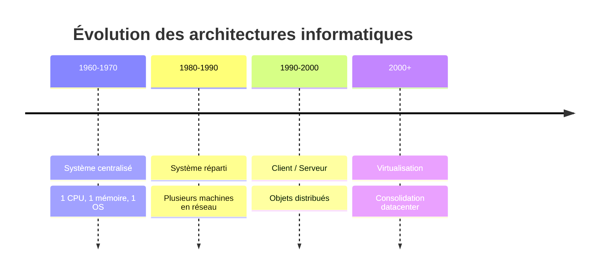

---

## PARTIE 2 : Pourquoi virtualiser ?

### Problème n°1 — Prolifération des serveurs
- Croissance énorme du nombre de serveurs physiques
- Manque d'espace physique
- Infrastructure rigide et coûteuse (matériel + licences)
- Manque d'efficacité énergétique

### Problème n°2 — Sous-exploitation des serveurs
Traditionnellement : **un serveur = une application** (web, fichiers, application, messagerie, impression, base de données...). Résultat : chaque serveur n'utilise que **5 à 15 % de sa puissance réelle**.

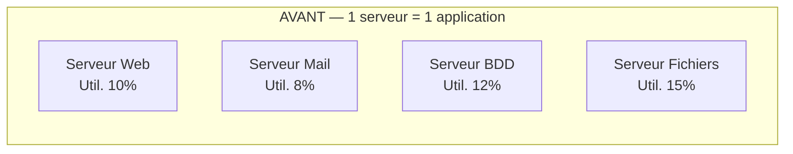

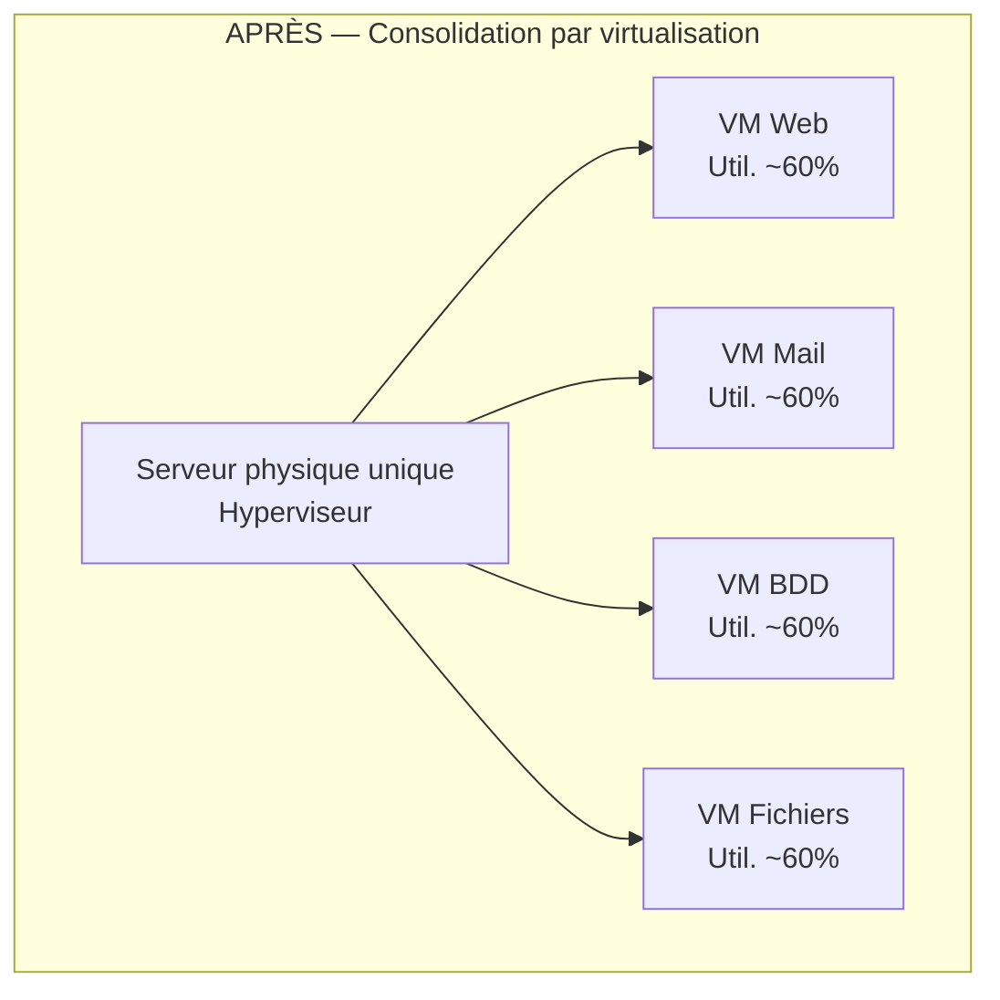

> **➡️ La solution** : consolider les charges de travail de plusieurs serveurs sous-exploités sur un seul serveur physique.

**Autres problèmes résolus** : serveurs de test rapides, déploiement rapide d'applications, surcapacité/saturation, couplage matériel/logiciel trop fort, conflits entre applications.

---

## PARTIE 3 : Le concept de virtualisation

**Définition** : la virtualisation utilise un logiciel pour créer une **couche d'abstraction** sur le matériel physique, permettant de diviser les ressources d'un seul ordinateur en plusieurs **machines virtuelles (VM)**.

### Les 3 composants majeurs

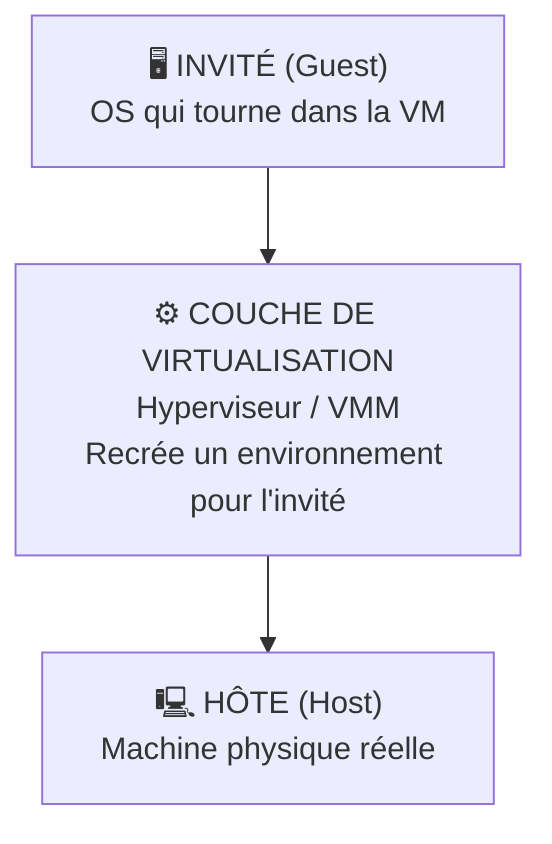

| Composant | Rôle |
|---|---|
| **Invité (guest)** | Interagit avec la couche de virtualisation au lieu de l'hôte |
| **Couche de virtualisation** | Recrée un environnement pour l'invité |
| **Hôte (host)** | Environnement d'origine, machine physique |

### Architecture complète (matériel → VMs)

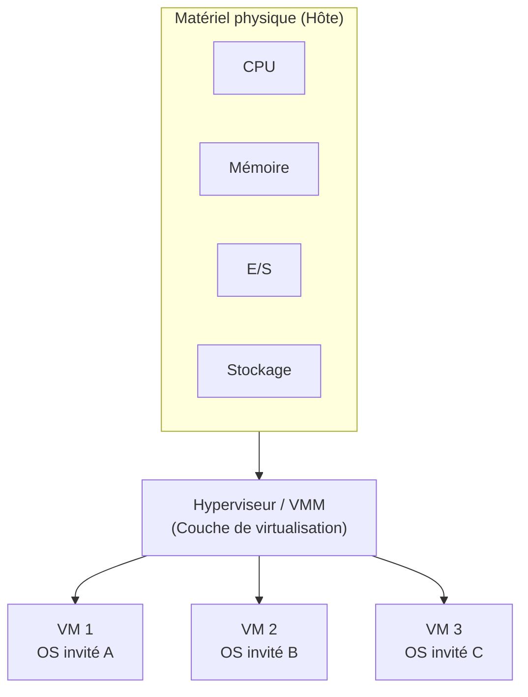

### Ancien serveur vs serveur virtualisé

| Sans virtualisation | Avec virtualisation |
|---|---|
| Un unique OS | Plusieurs OS |
| Matériel et logiciel étroitement couplés | Matériel et logiciel indépendants |
| Un plantage affecte tout | Applications isolées |
| Sous-utilisation des ressources | Ressources multiplexées en toute sécurité |

**Hyperviseur (VMM)** : logiciel qui gère plusieurs OS sur un seul système — gère CPU, mémoire et ressources, alloue ce dont chaque OS a besoin.

---

## PARTIE 4 : Les 4 caractéristiques fondamentales

> Point classique d'examen — à connaître par cœur.

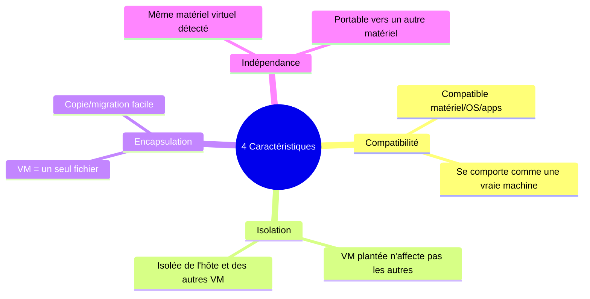

| Caractéristique | Explication |
|---|---|
| **Compatibilité** | Compatibilité totale matériel/OS/applications |
| **Isolation** | Une VM plantée n'affecte pas les autres |
| **Encapsulation** | État complet d'une VM = un seul fichier |
| **Indépendance** | Déplaçable vers un matériel différent sans modification |

---

## PARTIE 5 : Types d'hyperviseurs

### Architecture Type I — Bare Metal

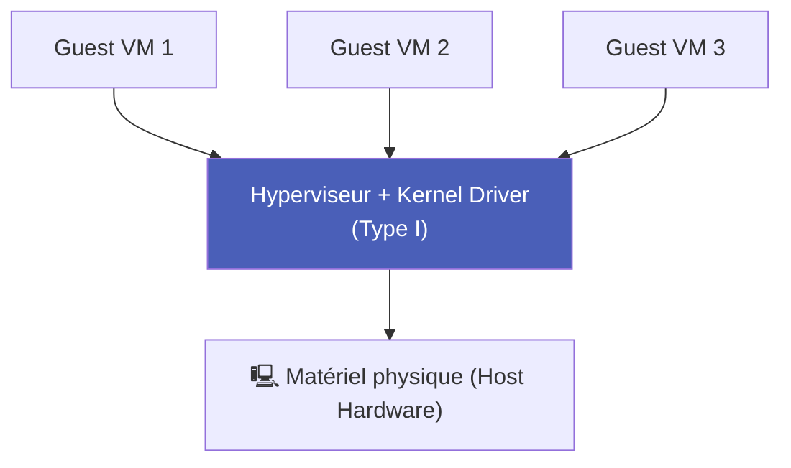
- Fonctionne **directement sur le matériel**
- Peut nécessiter la virtualisation assistée par matériel (CPU)
- Pilotes limités, fournis par l'éditeur
- **Exemples** : Xen (Citrix XenServer), Microsoft Hyper-V, VMware ESXi

### Architecture Type II — Hosted

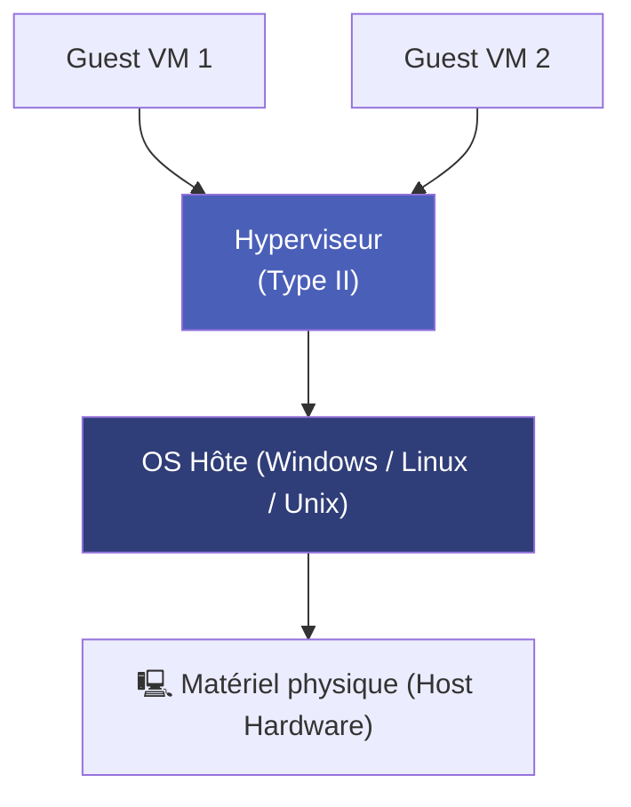
- Exécute des VM **au-dessus d'un OS hôte**
- S'appuie sur l'OS hôte pour gérer le matériel
- **Exemple** : VirtualBox

> **Analogie** : Type I = construire directement sur un terrain vide. Type II = installer une caravane dans le jardin d'une maison existante.

---

## PARTIE 6 : Les 5 domaines de virtualisation

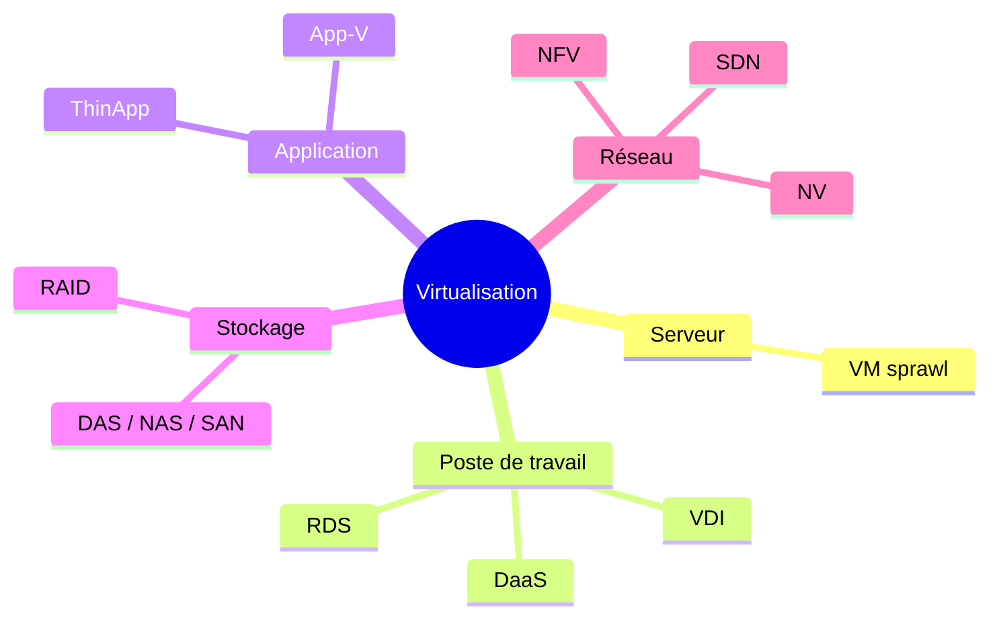

### a) Virtualisation de serveur
Isole les ressources d'un serveur physique en plusieurs environnements isolés.
> ⚠️ **VM sprawl** : étalement incontrôlé des VM inutiles → gaspillage de ressources et complications de licences.

### b) Virtualisation de poste de travail

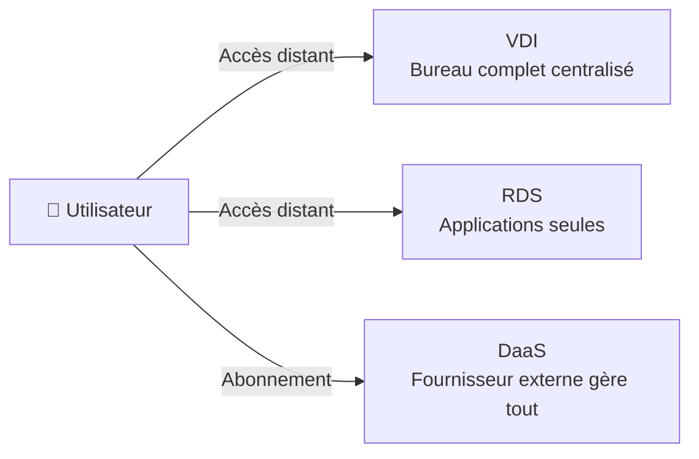

| Mode | Principe |
|---|---|
| **VDI** | Bureau complet centralisé — persistant ou non persistant |
| **RDS** | Seules les applications sont virtualisées → densité + élevée |
| **DaaS** | Fournisseur externe, abonnement mensuel |

### c) Virtualisation d'application
Application encapsulée avec son environnement (DLL, dépendances) → plus de conflits.
**Exemples** : VMware ThinApp, Microsoft App-V

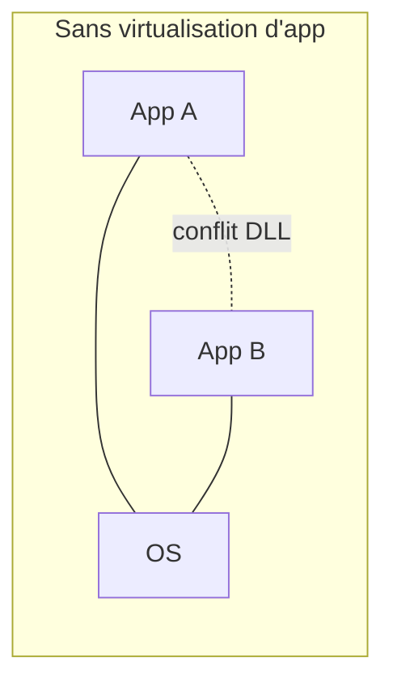

### d) Virtualisation de stockage

**RAID — architectures**

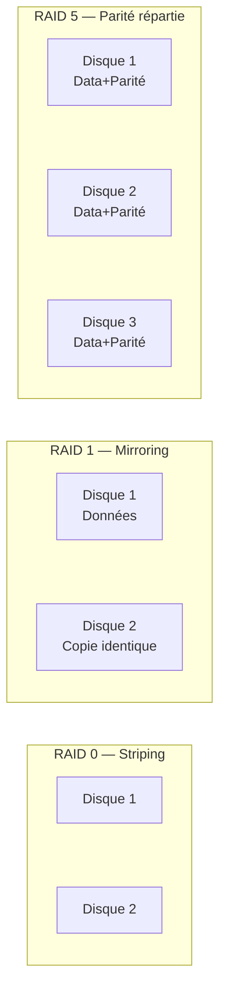

| Type | Principe | Tolérance de panne |
|---|---|---|
| RAID 0 | Striping — données réparties | Aucune |
| RAID 1 | Mirroring — duplication sur 2 disques | Oui |
| RAID 5 | Striping + parité répartie | Oui |
| RAID 10 (1+0) | Mirroring puis striping | Oui |
| RAID 01 (0+1) | Striping puis mirroring | Oui |

**Architectures de stockage réseau**

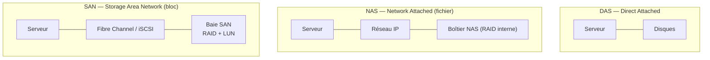

| Solution | Description |
|---|---|
| **DAS** | Stockage directement connecté au serveur |
| **NAS** | Réseau, niveau fichier, RAID interne |
| **SAN** | Réseau, niveau bloc, RAID + LUN, via iSCSI ou Fibre Channel |

**Fibre Channel** : fibre optique dédiée, vitesse gigabit, protocole FCP.
**iSCSI** : commandes SCSI sur réseau TCP/IP classique, carte réseau dédiée requise.

### e) Virtualisation de réseau

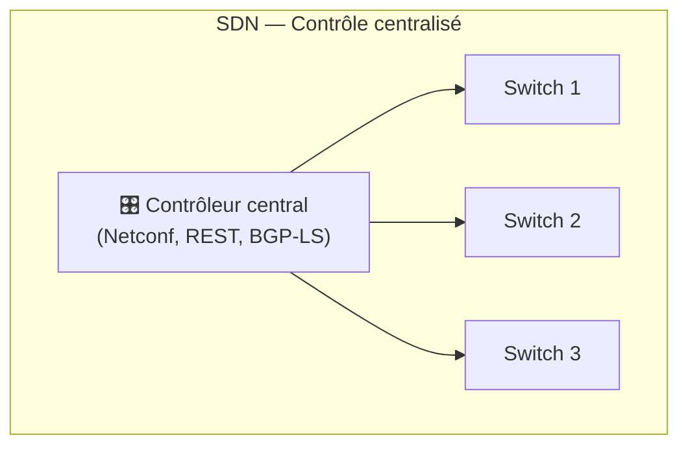

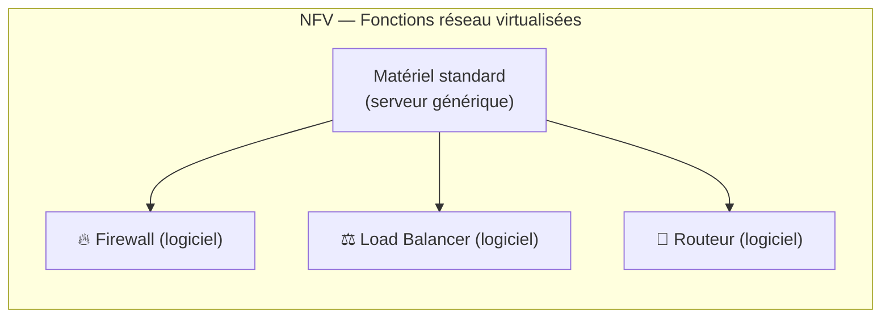

| Technologie | Principe |
|---|---|
| **NV** | Dissocie les services réseau du matériel, provisionnement logiciel |
| **SDN** | Centralise le **contrôle** du réseau |
| **NFV** | Virtualise les **fonctions** réseau sur matériel standard |

> ⚠️ **Ne pas confondre** : SDN = contrôle centralisé (comment on pilote) ; NFV = fonctions virtualisées (quel logiciel fait le travail).

---

## PARTIE 7 : Techniques de virtualisation CPU (x86)

### Anneaux de privilèges x86 (rings)

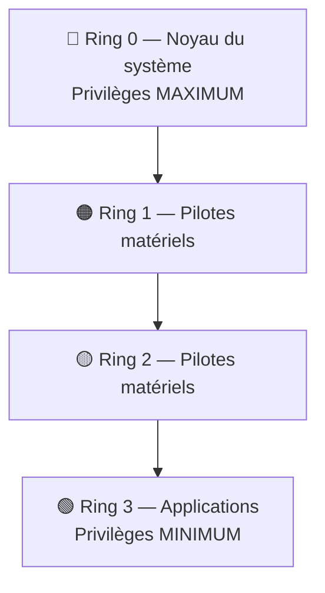

### Les 4 techniques d'exploitation du CPU

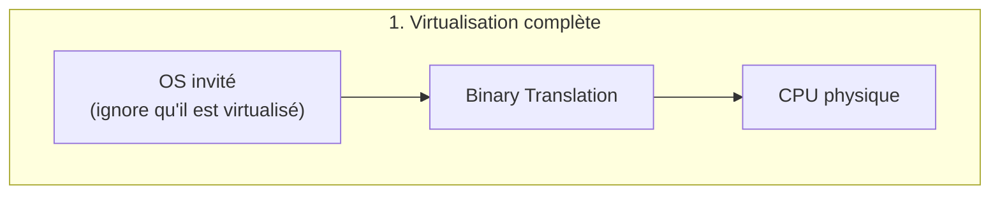

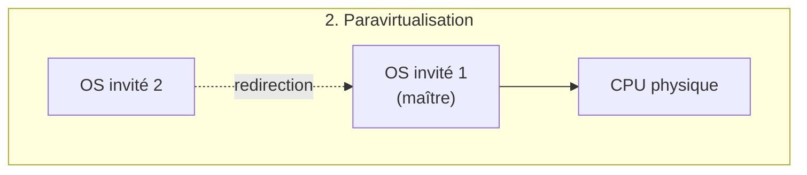

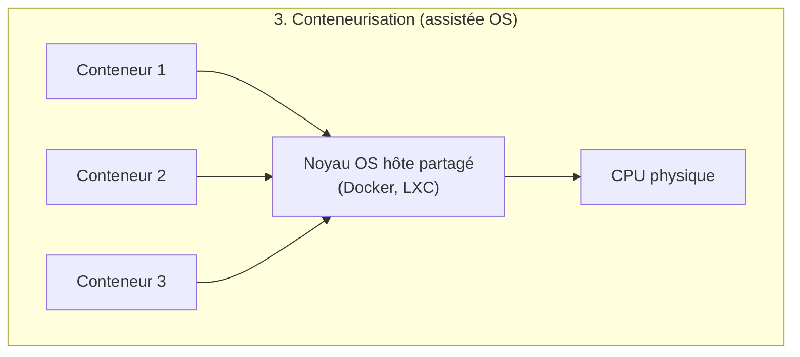

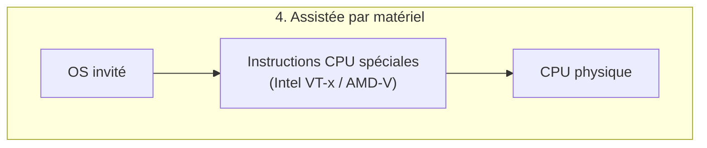

| Technique | Invité conscient ? | Overhead | Exemple |
|---|---|---|---|
| **Complète (Binary Translation)** | Non | Moyen (traduction) | VMware (historique) |
| **Paravirtualisation** | Oui | Faible | Xen (mode PV) |
| **Assistée OS (conteneurs)** | N/A — pas d'hyperviseur | Très faible | Docker, LXC |
| **Assistée par matériel** | Non | Très faible | Intel VT-x, AMD-V |

> **Point clé examen** : VM (hyperviseur) = OS complet par instance, démarrage en minutes. Conteneur = noyau partagé, démarrage en secondes.

---

## PARTIE 8 : Avantages de la virtualisation

```mermaid
mindmap
  root((Avantages))
    Réduction des coûts
      Moins de matériel
      Moins d'énergie
      TCO réduit
      ROI optimisé
    Qualité de service
      Moins d'indisponibilité
      Provisionnement instantané
      Répartition de charge dynamique
      PRA facilité
    Administration simplifiée
      Moins d'équipements
      Snapshots
      Infrastructure homogène
```

### 1. Réduction des coûts
- Moins de matériel nécessaire
- Réduction facture énergétique (électricité + climatisation)
- Réduction du **TCO** (Total Cost of Ownership)
- Optimisation du **ROI** (Return on Investment)

### 2. Amélioration de la qualité de service
- Réduction du temps d'indisponibilité
- **Approvisionnement instantané** (clonage de VM en minutes)
- **Répartition de charge dynamique**
- Mise en place facilitée du **PRA** (Plan de Reprise d'Activité)

### 3. Simplification de l'administration
> **Formule du cours** : Réduction du nombre d'équipements + Sauvegarde instantanée par snapshot + Homogénéité de l'infrastructure = Moins de maintenance, travail simplifié.

---

## Fiche de synthèse express

| À retenir | Détail |
|---|---|
| Type I vs Type II | Bare metal (datacenter) vs Hosted (poste client) |
| 4 caractéristiques | Compatibilité, Isolation, Encapsulation, Indépendance |
| VM vs Conteneur | OS complet vs noyau partagé (Docker) |
| RAID 0/1/5 | Vitesse sans tolérance / Miroir / Parité répartie |
| SDN vs NFV | Contrôle centralisé vs fonctions virtualisées |
| 4 techniques CPU | Complète, para-, assistée OS, assistée matériel |

### Questions de réflexion du cours
1. **L'OS invité de la VM 20 doit-il être identique à celui de la VM 1 ?** → Non, c'est le principe de l'isolation.
2. **Si on redémarre une VM, faut-il redémarrer l'hôte ?** → Non, c'est le principe de l'isolation.

---
*Document généré à partir du cours « Virtualisation » — Dr Afef Bohli & Dr Naourez Mejri*
