# Architecture IoT

---

## 1. Infrastructures de base

### Infrastructure élémentaire

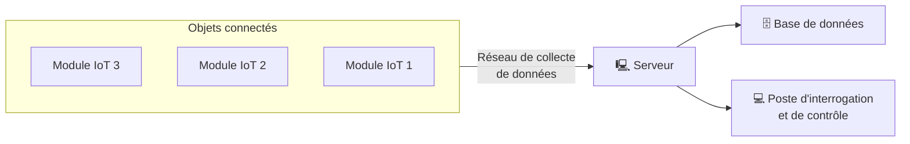

3 blocs fonctionnels :
1. **Modules IoT** reliés à un réseau de collecte de données
2. Un **serveur** central qui reçoit tout
3. Une **base de données** (stockage) + un **poste d'interrogation et de contrôle**

> **Analogie** : une ruche. Chaque abeille (module IoT) rapporte l'information à la ruche (serveur), qui stocke le miel (données) et permet à l'apiculteur (poste de contrôle) de consulter/gérer le tout.

### Infrastructure étendue

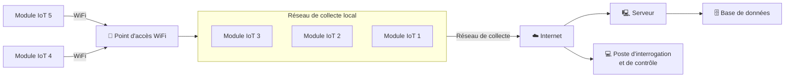

➡️ **Différence clé** : infrastructure élémentaire = **locale** (même site) ; infrastructure étendue passe par **Internet** → serveur et poste de contrôle accessibles à distance (cloud), et WiFi ajouté pour les modules sans câble.

---

## 2. Les composants d'une architecture IoT

**3 grandes familles de composants** :
1. **Objets intelligents** (industriels, domestiques, wearables)
2. **Passerelles** (gateways)
3. **Middlewares** : logiciel (applications) + matériel (BDD, serveurs)

### Chemin des données

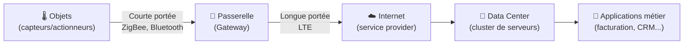

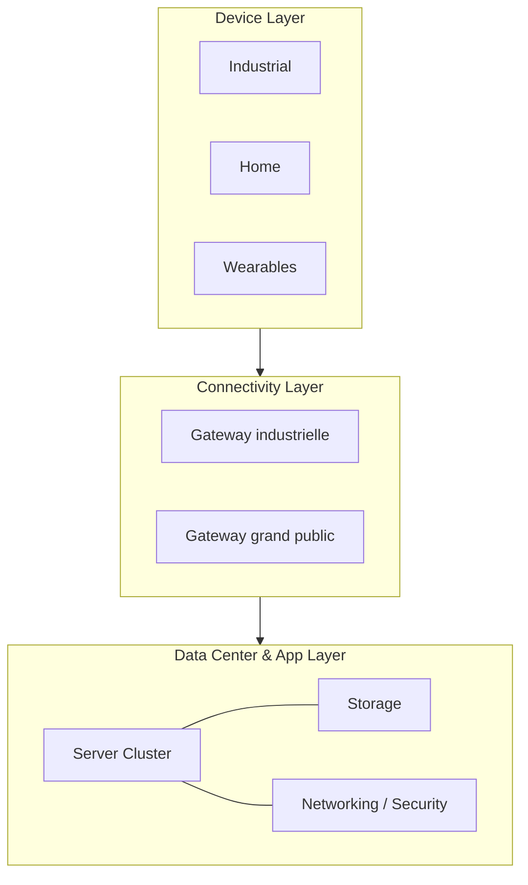

Trois couches se dessinent : **Device Layer** (objets) → **Connectivity Layer** (passerelles/réseau) → **Data Center & App Layer** (traitement).

### Exemple d'architecture réelle

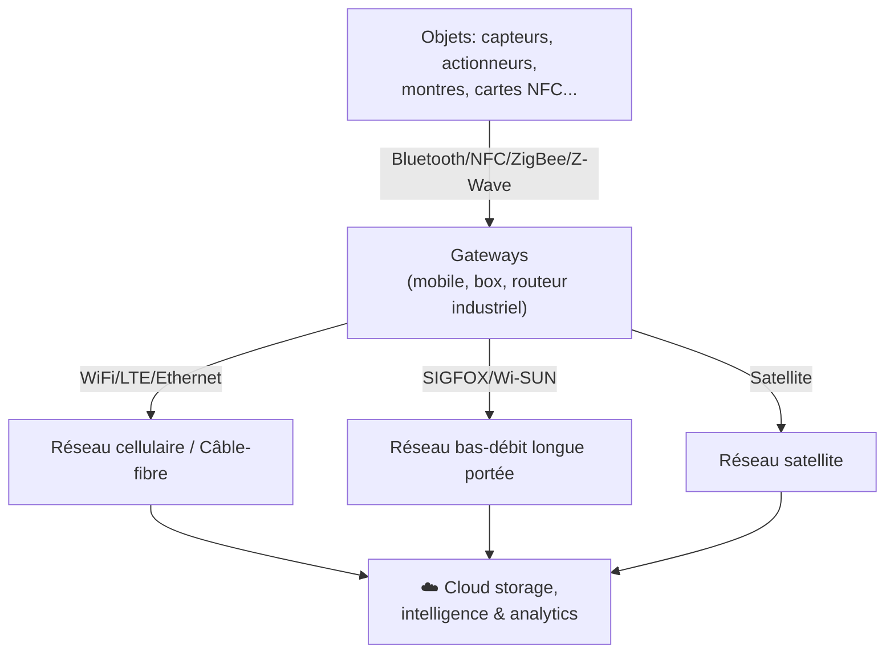

> ⚠️ **Point important** : il **n'existe pas d'architecture standard pour l'IoT**. On trouve des architectures à 3, 4, 5, 6 voire 7 couches selon les auteurs — ce n'est pas une erreur d'en voir plusieurs versions différentes.

---

## 3. Les architectures en couches

### Architecture à 3 couches

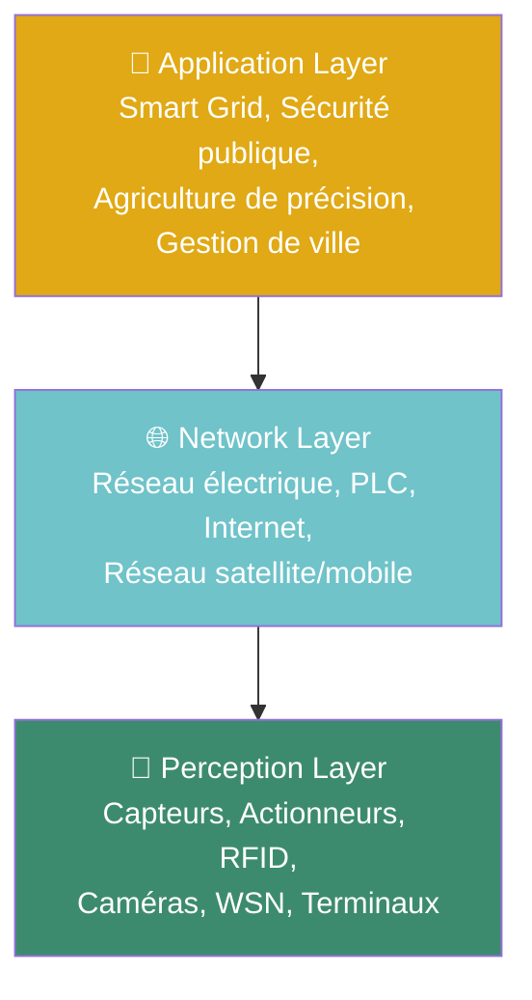

| Couche | Rôle |
|---|---|
| **Perception Layer** | Capteurs, actionneurs, RFID, caméras, microphones, WSN, terminaux intelligents |
| **Network Layer** | Transport des données (réseau électrique, PLC, Internet, satellite/mobile) |
| **Application Layer** | Traitement final selon le domaine |

### Architecture à 5 couches (orientée cloud/edge)

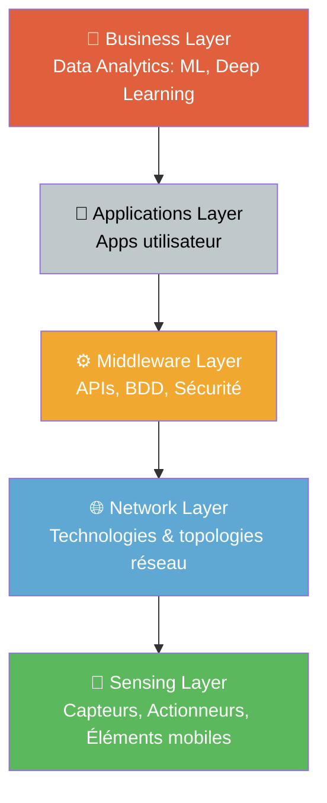

| Couche | Contenu | Type de computing |
|---|---|---|
| **Sensing Layer** | Capteurs, actionneurs, éléments mobiles | **Edge computing** |
| **Network Layer** | Technologies réseau (WiFi, ZigBee...), topologies | **Fog computing** |
| **Middleware Layer** | APIs, bases de données, sécurité | — |
| **Applications Layer** | Applications utilisateur finales | — |
| **Business Layer** | Data Analytics (ML, Deep Learning) | **Cloud computing** |

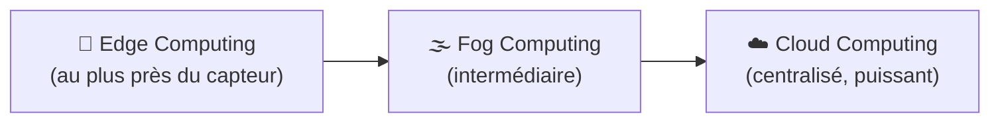

> Plus on monte dans les couches, plus on s'éloigne du capteur physique et plus on se rapproche de l'analyse intelligente des données.

---

## 4. Couche de perception — Capteurs et actionneurs

### Les 4 unités fonctionnelles

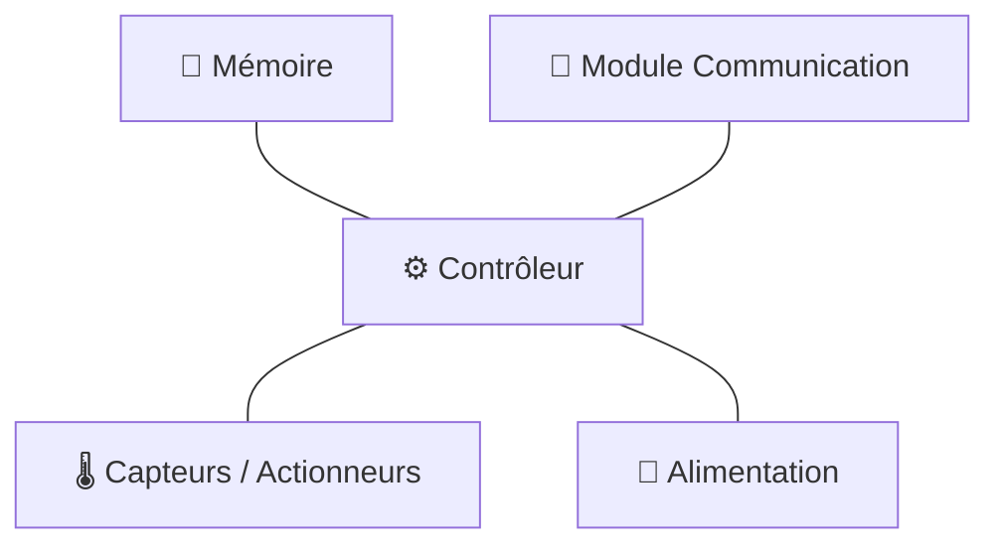

1. **Unité de détection** : Capteur/Actionneur
2. **Unité de traitement** : Contrôleur
3. **Unité de communication** : Module RF
4. **Alimentation**

### Capteurs classiques vs capteurs intelligents

| Capteur classique | Capteur intelligent |
|---|---|
| Transforme une grandeur physique en grandeur électrique | Intègre électronique additionnelle, unités programmables, logiciel embarqué |

### Architecture matérielle d'un capteur intelligent

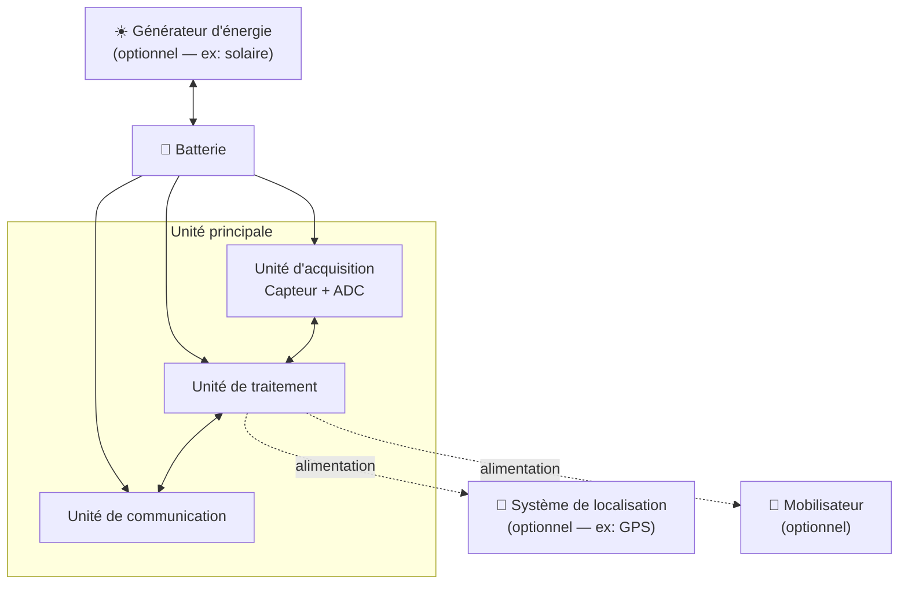

**4 unités obligatoires** : Acquisition, Traitement, Communication/Transmission, Énergie.
**3 composants optionnels** : système de localisation (GPS), générateur d'énergie (solaire), mobilisateur.

#### a) Unité d'acquisition
- **Récepteur** (capteur classique) : reconnaît la grandeur physique
- **Transducteur (ADC)** : convertit le signal analogique en signal numérique

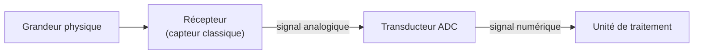

#### b) Unité de traitement
Recueille les données, les traite, décide quand/où les envoyer.
Types de processeurs : processeurs programmables, **DSP**, microcontrôleurs, microprocesseurs, **FPGA**, **ASIC**.

#### c) Unité de transmission
Caractérisée par : plage fréquentielle, technique de modulation, type de multiplexage, type de canal, étalement de spectre.
Modes : radiofréquence (RF), laser, infrarouge.

#### d) Unité d'énergie
Généralement une batterie (rechargeable ou non).
> ⚠️ Dans les environnements difficiles d'accès, impossible de recharger/changer la batterie → **l'énergie est la ressource la plus précieuse**, elle détermine la durée de vie du capteur et du réseau entier.

---

## 5. Microcontrôleurs

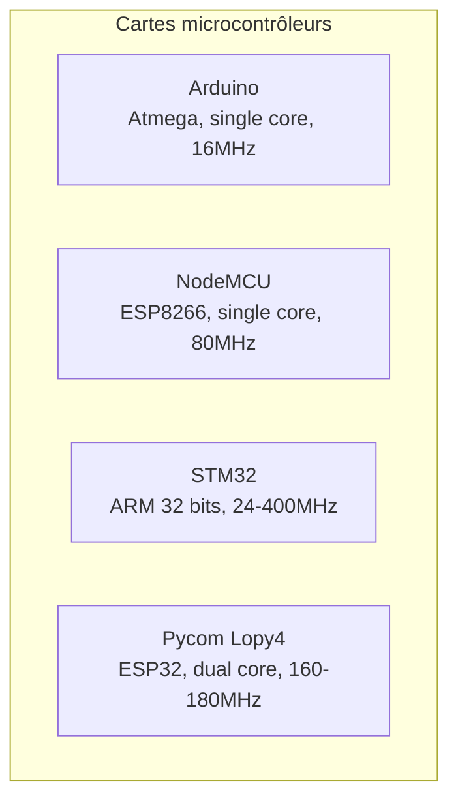

| Carte | Base | Points forts |
|---|---|---|
| **Arduino** | µc Atmega (single core, 16 MHz) | Connexion simple, bon pour capteurs |
| **STM32** | µc ARM 32 bits (24-400 MHz) | Capteurs ET traitement local |
| **NodeMCU** | µc ESP8266 (single core, 80 MHz) | WiFi intégré |
| **Pycom Lopy4** | µc ESP32 (dual core, 160-180 MHz) | WiFi, Bluetooth, Sigfox, LoRa |

---

## 6. GPIO, Input/Output, Analog/Digital

**GPIO** (General Purpose Input/Output) = ports d'entrées-sorties permettant de communiquer avec les composants externes.

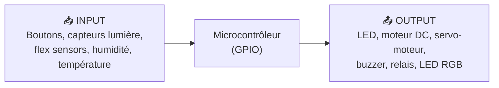

**Signal analogique vs numérique**

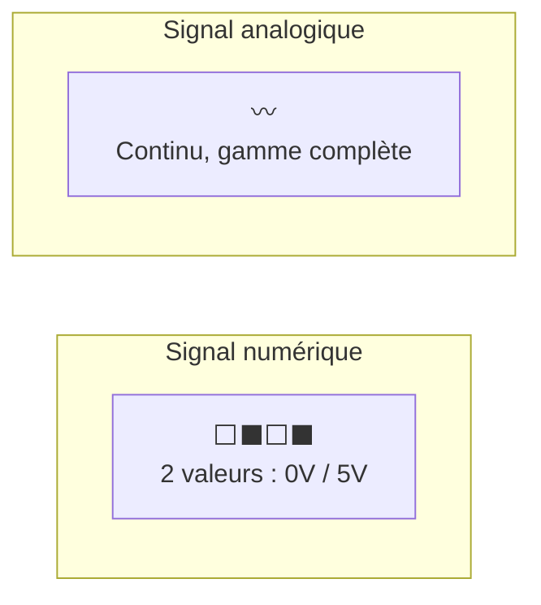

---

## 7. Le convertisseur ADC

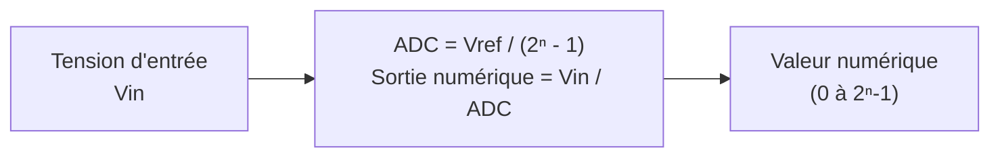

**Formule du cours** :

$$ADC = \frac{V_{ref}}{2^n - 1} \qquad \text{Sortie numérique} = \frac{V_{in}}{ADC}$$

Où **n** = résolution en bits, **Vref** = tension maximale convertible.

### Carte UNO / ATMEGA328 (référence du cours)

| Caractéristique | Valeur |
|---|---|
| Tension d'alimentation | 5V |
| E/S numériques | 14 (dont 6 PWM) |
| Entrées analogiques | 6 |
| Résolution binaire | 10 bits |
| Mémoire Flash | 32 Ko (0.5 Ko bootloader) |
| Mémoire SRAM | 2 Ko |
| Mémoire EEPROM | 1 Ko |
| Fréquence horloge | 16 MHz |

### Exemples résolus (résolution 10 bits, Vref = 5V)

| Vin | Calcul | Valeur numérique |
|---|---|---|
| 0V | (0/5) × 1023 | **0** |
| 2.5V | (2.5/5) × 1023 | **≈ 512** |
| 5V | (5/5) × 1023 | **1023** |
| 3.3V | (3.3/5) × 1023 | **≈ 673** |

### Résolution 12 bits (4096 niveaux)

| Vin | Calcul | Valeur numérique |
|---|---|---|
| 2.0V | (2.0/5) × 4096 | **≈ 1638** |
| 4.8V | (4.8/5) × 4096 | **≈ 3932** |

### Sens inverse (retrouver Vin depuis la valeur numérique)

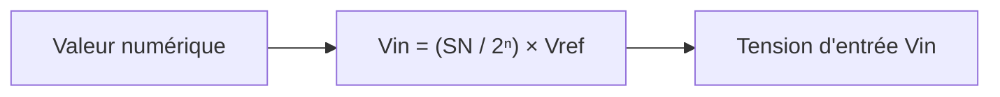

- Résolution 8 bits (256 niveaux), valeur = 128, plage 0-3V → (128/256) × 3V = **1.5V**
- Résolution 12 bits (4096 niveaux), valeur = 2048, plage 0-10V → (2048/4096) × 10V = **5V**
- Résolution 16 bits (65536 niveaux), valeur = 32768, plage -5V à +5V → milieu de plage = **0V (soit +5V au-dessus du minimum)**

---

## Fiche de synthèse express

| À retenir | Détail |
|---|---|
| Pas d'architecture standard IoT | 3 à 7 couches selon les auteurs |
| Architecture à 3 couches | Perception → Network → Application |
| Architecture à 5 couches | Sensing (Edge) → Network (Fog) → Middleware → Applications → Business (Cloud) |
| 4 unités du capteur intelligent | Acquisition, Traitement, Communication, Énergie |
| Formule ADC | ADC = Vref / (2ⁿ - 1) ; Sortie numérique = Vin / ADC |
| Cartes courantes | Arduino, STM32, NodeMCU, Pycom Lopy4 |

---
*Document généré à partir du cours « Architecture IoT »*
