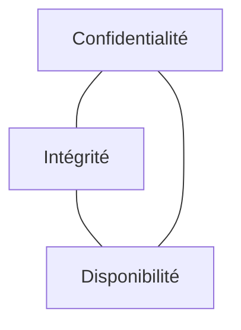
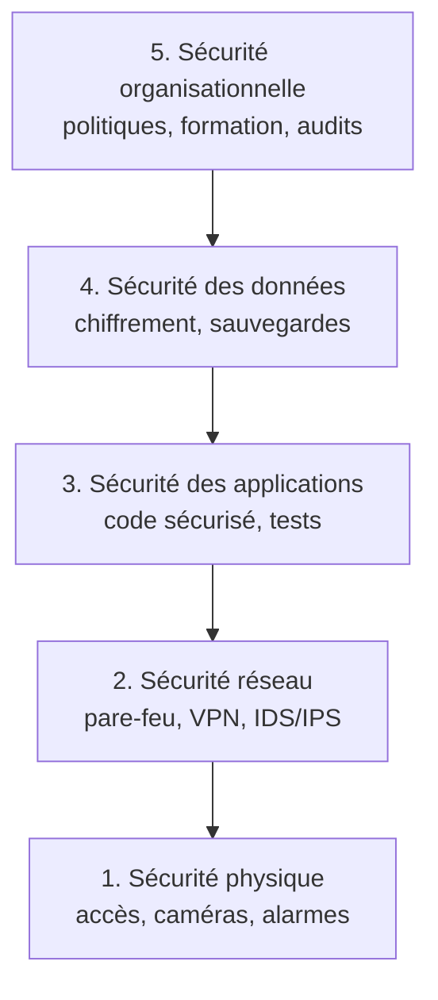
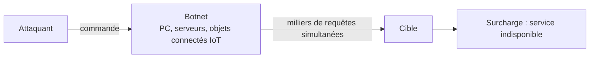
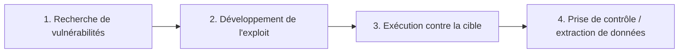
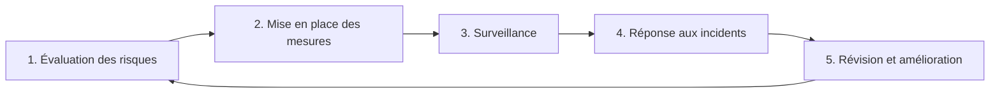
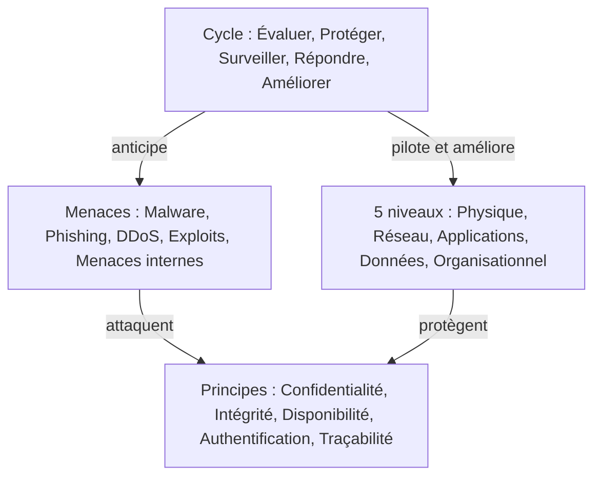

# Chapitre 1 — Aspects généraux de la sécurité informatique

> **Cours 3LGL — Institut Supérieur d'Informatique du Kef**
> Version expliquée et enrichie du support de Mme Mounira Laabidi, rédigée comme un cours d'ingénieur senior : chaque notion est définie, expliquée avec des exemples concrets, puis résumée.

---

## Table des matières

1. [Vue d'ensemble et logique du cours](#1-vue-densemble-et-logique-du-cours)
2. [Partie A — La sécurité : définition, principes, nécessité](#partie-a--la-sécurité-informatique)
3. [Partie B — Les niveaux de sécurisation](#partie-b--les-niveaux-de-sécurisation)
4. [Partie C — Les menaces](#partie-c--les-menaces)
5. [Partie D — Le cycle de la sécurité](#partie-d--le-cycle-de-la-sécurité)
6. [Synthèse globale](#synthèse-globale)
7. [Glossaire](#glossaire)
8. [Questions de révision](#questions-de-révision)

---

## 1. Vue d'ensemble et logique du cours

Le chapitre répond à quatre questions simples, dans cet ordre :

| Question | Partie du cours |
|---|---|
| **Qu'est-ce qu'on protège, et selon quels principes ?** | Définition, principes, nécessité |
| **Où et comment protège-t-on ?** | Les 5 niveaux de sécurisation |
| **Contre quoi protège-t-on ?** | Les menaces (malware, phishing, DDoS, exploits) |
| **Comment gérer la sécurité dans le temps ?** | Le cycle de la sécurité |

**Idée maître à retenir :** la sécurité n'est **pas un produit** que l'on installe une fois (un antivirus, par exemple). C'est un **processus continu** qui combine des aspects **techniques, humains et organisationnels**.

---

# Partie A — La sécurité informatique

## A.1 Définition

> La **sécurité informatique** désigne l'ensemble des **mesures et pratiques** visant à protéger les **systèmes informatiques, les réseaux, les données et les informations** contre les **accès non autorisés, les cyberattaques, les pertes et les dommages**.

**Décryptage :**

- **Mesures et pratiques** : des outils (pare-feu), mais aussi des habitudes (ne pas cliquer sur un lien suspect).
- **Systèmes, réseaux, données, informations** : quatre choses différentes à protéger.
- **Accès non autorisés, cyberattaques, pertes, dommages** : les menaces peuvent être *volontaires* (attaque) ou *accidentelles* (erreur, panne, incendie).

---

## A.2 Les principes fondamentaux

Le cours présente **5 principes**. Les trois premiers forment la célèbre **triade CIA** (en français **CID**).

### 1) Confidentialité

**Définition :** seules les personnes **autorisées** peuvent accéder à l'information.

- **Exemple :** seul le médecin peut lire ton dossier médical.
- **Menace :** vol de données, fuite, espionnage.
- **Moyens :** chiffrement, mots de passe, contrôle d'accès.

### 2) Intégrité

**Définition :** les données ne sont **ni modifiées, ni altérées** sans autorisation.

- **Exemple :** le montant d'un virement bancaire ne doit pas être changé pendant son transfert.
- **Menace :** modification malveillante, corruption de fichier.
- **Moyens :** signatures numériques, hachage (SHA-256), contrôle des droits d'écriture.

### 3) Disponibilité

**Définition :** l'information et les systèmes sont **accessibles et utilisables quand on en a besoin**.

- **Exemple :** un site e-commerce doit rester en ligne pendant les soldes.
- **Menace :** attaque DDoS, panne, ransomware.
- **Moyens :** sauvegardes, redondance des serveurs, protection anti-DDoS.

### 4) Authentification

**Définition :** **vérifier l'identité** des utilisateurs et des systèmes avant de leur donner accès.

- **Exemple :** mot de passe + code SMS (authentification à deux facteurs).
- Les trois grandes familles de preuves : **ce que je sais** (mot de passe), **ce que je possède** (téléphone, carte), **ce que je suis** (empreinte).

### 5) Traçabilité

**Définition :** **enregistrer et surveiller** les actions des utilisateurs pour détecter les anomalies.

- **Exemple :** les journaux (logs) montrent qui s'est connecté au serveur, à quelle heure.
- Sert aussi de **preuve** en cas d'enquête après un incident.

### Résumé en un tableau

| Principe | Question à se poser | Exemple d'atteinte |
|---|---|---|
| Confidentialité | Qui peut **lire** ? | Fuite de mots de passe |
| Intégrité | Qui peut **modifier** ? | Falsification d'une note ou d'un montant |
| Disponibilité | Est-ce **accessible** ? | Site rendu inaccessible par DDoS |
| Authentification | Qui es-tu **vraiment** ? | Usurpation d'identité |
| Traçabilité | Qui a **fait quoi** et quand ? | Absence de logs après une intrusion |

> **Astuce mémo :** *Confidentialité = secret, Intégrité = exactitude, Disponibilité = accès.*

---

## A.3 Pourquoi la sécurité est nécessaire

Le cours donne **4 raisons** :

| Raison | Explication |
|---|---|
| **Protection des données** | Éviter les violations de données qui causent des pertes financières et nuisent à la réputation |
| **Conformité légale** | Respecter les lois sur la protection des données (en Tunisie : loi organique sur la protection des données personnelles ; en Europe : RGPD) |
| **Continuité des activités** | Empêcher que les cyberattaques interrompent l'activité de l'entreprise |
| **Confiance des utilisateurs** | Clients et partenaires font confiance aux services qu'ils savent sécurisés |

---

# Partie B — Les niveaux de sécurisation

La sécurité s'applique à **5 niveaux** complémentaires. Le principe clé est la **défense en profondeur** : on empile plusieurs couches, comme un château (fossé, mur, porte, gardes). Si une couche tombe, les autres protègent encore.

---

## B.1 Sécurité physique

**Idée :** si quelqu'un peut entrer dans la salle des serveurs et emporter un disque dur, aucun pare-feu ne sert à rien.

### Objectifs

1. **Protection des équipements** : éviter vol, sabotage, dommages (serveurs, PC, matériel).
2. **Intégrité des données** : empêcher qu'un accès physique non autorisé altère ou supprime des données.
3. **Continuité des services** : garder les systèmes opérationnels malgré un incendie, une inondation, etc.

### Éléments

| Catégorie | Détails |
|---|---|
| **1. Contrôles d'accès physiques** | **Badges / cartes RFID** (limitent l'accès aux zones sensibles) ; **biométrie** (empreinte, reconnaissance faciale) ; **clés physiques** (avec gestion stricte : qui a quelle clé ?) |
| **2. Surveillance et détection** | **Vidéosurveillance** (surveille et dissuade) ; **détection de mouvement** (alerte en cas d'intrusion) ; **alarmes** (déclenchées lors d'un accès non autorisé) |
| **3. Barrières physiques** | Clôtures, portes renforcées, cages pour serveurs |
| **4. Environnement contrôlé** | Climatisation, détection incendie, onduleurs (UPS), protection contre l'humidité |
| **5. Gestion des visiteurs** | Registre, badge visiteur, accompagnement obligatoire |
| **6. Équipement de sécurité** | Extincteurs, coffres-forts, gardiennage |

---

## B.2 Sécurité réseau

**Idée :** protéger les **communications** et le **périmètre** du réseau.

### Objectifs

1. **Protection des données** en transit (confidentialité + intégrité).
2. **Prévention des intrusions** : bloquer les accès non autorisés.
3. **Maintien de la disponibilité** des services réseau.

### Éléments (8 au total)

#### 1) Pare-feu (Firewall)

- **Fonctionnement :** barrière entre le réseau interne et l'extérieur ; il **filtre le trafic selon des règles** définies.
- **Types :**
  - **Matériel** (équipement dédié),
  - **Logiciel** (installé sur une machine),
  - **NGFW** (*Next-Generation Firewall*) : fonctions avancées comme l'**inspection approfondie des paquets (DPI)**, qui regarde le *contenu* des paquets et pas seulement leurs adresses.

**Analogie :** le vigile d'un immeuble qui vérifie la liste des invités.

#### 2) IDS / IPS

| | **IDS** (Intrusion Detection System) | **IPS** (Intrusion Prevention System) |
|---|---|---|
| Rôle | **Détecte** et alerte | **Détecte et bloque** |
| Analogie | Caméra de surveillance | Vigile qui arrête l'intrus |
| Action | Passive | Active |

#### 3) VPN (Réseau Privé Virtuel)

- **Fonctionnement :** crée un **tunnel chiffré** pour les connexions à distance, même sur un réseau public (Wi-Fi d'un café).
- **Utilisation :** un employé en déplacement accède aux ressources de l'entreprise en sécurité.

#### 4) Chiffrement

- **Transmission sécurisée :** protocoles **SSL/TLS** (le cadenas HTTPS) chiffrent les données pendant le transfert et empêchent l'interception.
- **Stockage sécurisé :** chiffrement des données **au repos** sur les serveurs.

#### 5) Contrôle d'accès

Définir qui peut se connecter à quoi (comptes, rôles, principe du **moindre privilège** : chacun n'a que les droits dont il a besoin).

#### 6) Mise à jour et gestion des correctifs (*patch management*)

Installer régulièrement les mises à jour pour **corriger les vulnérabilités connues**.

#### 7) Segmentation du réseau

Diviser le réseau en zones (ex. : réseau des invités, réseau des employés, réseau des serveurs, **DMZ**). Si un attaquant entre dans une zone, il ne peut pas se propager partout.

#### 8) Surveillance et journalisation

Collecter et analyser les logs pour détecter les comportements anormaux.

### Importance de la sécurité réseau

1. **Prévention des pertes de données** (fuites, accès non autorisés).
2. **Protection contre les cyberattaques** (ransomwares, DDoS, phishing).
3. **Conformité réglementaire**.
4. **Confiance des clients**.

---

## B.3 Sécurité des applications

**Définition :** protéger les logiciels et applications contre les menaces et vulnérabilités **tout au long de leur cycle de vie** (conception, développement, test, déploiement, maintenance).

**But :** qu'une application ne compromette pas la **confidentialité, l'intégrité et la disponibilité** des données qu'elle traite.

### Objectifs

1. **Protection des données sensibles** (personnelles, financières).
2. **Prévention des vulnérabilités** : trouver et corriger les failles *avant* les attaquants.
3. **Conformité aux réglementations**.

### Éléments (7)

| # | Élément | Explication |
|---|---|---|
| 1 | **Sécurisation du cycle de développement** | Intégrer la sécurité dès la conception (approche *Secure SDLC* / *DevSecOps*) |
| 2 | **Analyse de vulnérabilités et tests de sécurité** | Scans automatiques, revue de code, tests de pénétration |
| 3 | **Contrôles d'accès et authentification** | Rôles, mots de passe hachés, MFA |
| 4 | **Chiffrement** | Données sensibles chiffrées (ex. : mots de passe hachés avec bcrypt/Argon2) |
| 5 | **Gestion des sessions** | Jetons sécurisés, expiration, déconnexion propre |
| 6 | **Protection contre les menaces courantes** | Injection SQL, XSS, CSRF… (voir liste OWASP Top 10) |
| 7 | **Logging et surveillance** | Journaliser les événements importants sans y mettre de données sensibles |

> **Pour toi, futur développeur :** c'est le niveau où **tu** as le plus de pouvoir. Valider toutes les entrées utilisateur, utiliser des requêtes paramétrées et ne jamais stocker un mot de passe en clair sont des réflexes essentiels.

---

## B.4 Sécurité des données

**Définition :** pratiques, technologies et politiques pour protéger les données contre **accès non autorisés, modifications, destructions et fuites**.

Elle couvre deux états des données :

- **Au repos** (*data at rest*) : stockées sur disque, base de données, sauvegarde.
- **En transit** (*data in motion*) : circulant sur un réseau.

### Objectifs

Confidentialité, Intégrité, Disponibilité (la triade CID appliquée aux données).

### Éléments (6)

1. **Chiffrement** — rendre les données illisibles sans la clé.
2. **Contrôles d'accès** — qui peut lire, écrire, supprimer.
3. **Sauvegarde et restauration** — copies régulières et **testées** (règle **3-2-1** : 3 copies, 2 supports différents, 1 hors site).
4. **Surveillance et journalisation** — détecter les accès suspects.
5. **Sensibilisation et formation** — l'humain est souvent le maillon faible.
6. **Protection physique** — protéger les supports de stockage.

### Importance

| Bénéfice | Explication |
|---|---|
| Protection contre les violations | Réduit le risque de fuite |
| Réputation | Maintient la confiance des clients |
| Réduction des pertes financières | Moins d'amendes et de frais de récupération |
| Conformité légale | Évite sanctions et poursuites |

---

## B.5 Sécurité organisationnelle

**Définition :** ensemble des **mesures, politiques et pratiques** d'une organisation pour protéger ses actifs, ses informations et ses employés contre les menaces **internes et externes**. Elle englobe les aspects **humains, procéduraux et techniques**.

### Objectifs

1. **Protection des informations sensibles.**
2. **Prévention des incidents** (intentionnels ou accidentels).
3. **Culture de la sécurité** : chaque membre comprend son rôle.

### Éléments (7)

| # | Élément | En pratique |
|---|---|---|
| 1 | **Politiques de sécurité** | Documents officiels : charte informatique, politique de mots de passe |
| 2 | **Sensibilisation et formation** | Ateliers, simulations de phishing |
| 3 | **Gestion des identités et des accès (IAM)** | Création, modification, suppression des comptes selon les rôles |
| 4 | **Surveillance et audit** | Contrôles réguliers du respect des règles |
| 5 | **Gestion des incidents** | Procédure claire quand un incident survient |
| 6 | **Gestion des risques** | Identifier, évaluer, traiter les risques |
| 7 | **Sécurité physique** | Lien avec le niveau 1 |

### Importance

Protection des actifs, confiance des clients, conformité légale, prévention des pertes financières.

---

### Tableau récapitulatif des 5 niveaux

| Niveau | Protège | Outils / exemples clés |
|---|---|---|
| **Physique** | Locaux, matériel | Badges, biométrie, caméras, alarmes |
| **Réseau** | Communications, périmètre | Pare-feu, VPN, IDS/IPS, TLS, segmentation |
| **Applications** | Logiciels | Code sécurisé, tests, gestion de sessions |
| **Données** | Informations | Chiffrement, sauvegardes, contrôle d'accès |
| **Organisationnel** | Personnes et processus | Politiques, formation, audits, IAM |

---

# Partie C — Les menaces

Le cours en identifie **5 grandes familles** :

| # | Menace | Définition courte |
|---|---|---|
| 1 | **Malware** | Logiciels malveillants (virus, vers, ransomware…) |
| 2 | **Phishing** | Fraude par messages trompeurs pour voler des informations |
| 3 | **Attaques DDoS** | Surcharge d'un service pour le rendre indisponible |
| 4 | **Exploits de vulnérabilité** | Utilisation de failles dans les logiciels/systèmes |
| 5 | **Menaces internes** | Employés malveillants ou négligents |

**Lien avec la triade CID :**

- Malware ransomware → **Disponibilité** (et confidentialité)
- Phishing → **Confidentialité**
- DDoS → **Disponibilité**
- Exploits → les trois, selon la faille
- Menaces internes → les trois

---

## C.1 Malware (logiciels malveillants)

Il existe **8 types** à connaître :

| Type | Comment ça marche | Point clé pour le distinguer |
|---|---|---|
| **1. Virus** | S'attache à un fichier ou programme légitime ; se propage quand on l'**exécute** | A besoin d'un **hôte** et d'une action de l'utilisateur |
| **2. Ver (Worm)** | Se reproduit et se propage **de façon autonome** à travers un réseau, souvent via des vulnérabilités | **Autonome**, aucune action nécessaire |
| **3. Cheval de Troie (Trojan)** | Se déguise en logiciel légitime pour inciter à l'installation ; peut donner accès aux attaquants | Repose sur la **tromperie** |
| **4. Ransomware** | **Chiffre** les données et exige une **rançon** contre la clé de déchiffrement | Peut **paralyser** une entreprise |
| **5. Spyware** | **Espionne** l'utilisateur sans consentement (identifiants, navigation) | Discret, collecte des données |
| **6. Adware** | Affiche des **publicités intrusives**, suit la navigation | Pas toujours malveillant, mais invasif |
| **7. Rootkit** | **Cache** la présence d'autres malwares et permet un accès discret | Difficile à détecter |
| **8. Botnet** | **Réseau de machines infectées** contrôlées à distance (ex. pour des DDoS) | Machines appelées « zombies » |

**Différence virus / ver (question d'examen fréquente) :**

- Le **virus** a besoin d'un fichier hôte et d'une exécution par l'utilisateur.
- Le **ver** se propage **tout seul** par le réseau.

---

## C.2 Phishing (hameçonnage)

**Définition :** technique de fraude qui vise à obtenir des informations sensibles (mots de passe, numéros de carte) par des messages qui **imitent une source de confiance**. C'est de l'**ingénierie sociale** : on attaque l'humain, pas la machine.

### Les 6 types

| Type | Canal | Cible | Exemple du cours |
|---|---|---|---|
| **Phishing par e-mail** | E-mail | Grand public (envoi de masse) | E-mail « de votre banque » demandant de vérifier votre compte |
| **Spear phishing** | E-mail personnalisé | Un individu / une organisation précise | E-mail « d'un collègue » demandant de valider une facture |
| **Whaling** | E-mail | Dirigeants (C-suite) | E-mail frauduleux « d'un dirigeant » demandant une action urgente sur des fonds |
| **Smishing** | SMS | Grand public | SMS « de l'opérateur » demandant de confirmer des infos |
| **Vishing** | Appel téléphonique | Grand public | Appel « du support technique » demandant vos identifiants |
| **Phishing sur réseaux sociaux** | Messages directs, faux profils | Utilisateurs de réseaux sociaux | Faux compte d'entreprise demandant de « vérifier votre compte » |

**Mnémotechnique :** *Smishing = **SMS***, *Vishing = **V**oice*, *Whaling = **baleine** (grosse cible)*, *Spear = **lance** (visé)*.

### Comment reconnaître une tentative de phishing

1. **Adresse d'expéditeur suspecte** (ex. `support@paypa1.com` avec un « 1 » au lieu de « l »).
2. **Langage d'urgence** (« Votre compte sera bloqué dans 24h ! »).
3. **Liens suspects** : survoler le lien pour voir l'URL réelle avant de cliquer.
4. **Demande d'informations personnelles** par e-mail ou message.
5. **Fautes d'orthographe ou de grammaire.**

### Comment s'en protéger

1. **Vérifier les sources** : ne pas cliquer, aller directement sur le site officiel.
2. **Outils de sécurité** : antivirus, filtres anti-phishing.
3. **Mises à jour régulières.**
4. **Sensibilisation et formation.**
5. **Authentification multifacteur (MFA)** : même si le mot de passe est volé, l'attaquant ne peut pas se connecter sans le second facteur.

---

## C.3 Attaques DDoS

### Définition

**DDoS = Distributed Denial of Service** (déni de service distribué). Tentative de rendre un service, un site ou une ressource **indisponible** en le **surchargeant de trafic** provenant de **nombreuses sources**. Elle attaque la **disponibilité**.

**Analogie :** mille personnes qui appellent en même temps le standard d'un restaurant : les vrais clients ne peuvent plus réserver.

### Fonctionnement en 3 étapes

1. **Botnet :** ensemble d'appareils infectés et contrôlés par l'attaquant.
2. **Lancement :** l'attaquant ordonne l'envoi de requêtes (HTTP, ping ICMP, requêtes DNS…).
3. **Surcharge :** la cible ne peut plus répondre aux requêtes **légitimes**.

### Les 4 types

| Type | Cible | Principe | Exemples |
|---|---|---|---|
| **Volumétrique** | Bande passante | Saturer avec un énorme volume de données | UDP Flood, ICMP Flood |
| **Par amplification** | Bande passante | Exploiter des protocoles mal configurés : une **petite requête** génère une **énorme réponse** dirigée vers la victime | DNS amplification, NTP amplification |
| **De protocole** | Ressources des serveurs | Exploiter des faiblesses dans le traitement des protocoles | SYN Flood, Slowloris |
| **Applicative** | Une application précise | Requêtes conçues pour submerger l'application | HTTP Flood, attaques ciblant les API |

### Conséquences

- **Indisponibilité du service** → perte de revenus.
- **Dommages à la réputation** → perte de confiance.
- **Coûts financiers** → mitigation et réponse à incident.

### Défenses (pour aller plus loin)

Services anti-DDoS (CDN, *scrubbing*), limitation du débit (*rate limiting*), redondance et répartition de charge, pare-feu applicatif (WAF).

---

## C.4 Exploits de vulnérabilité

### Définition

Une **vulnérabilité** est une faille (dans un logiciel, un système d'exploitation, un matériel). Un **exploit** est un **code ou une technique qui tire parti de cette faille** pour agir de façon non autorisée : accéder à un système, exécuter du code malveillant, voler des informations.

> **Vulnérabilité = la porte mal fermée. Exploit = l'outil qui l'ouvre.**

### Types de vulnérabilités

| Type | Explication | Exemple simplifié |
|---|---|---|
| **Débordement de tampon** (*buffer overflow*) | Un programme écrit plus de données que la mémoire prévue ne peut en contenir, écrasant des données voisines | Verser 2 L dans un verre de 1 L : ça déborde sur la table |
| **Injection SQL** | L'attaquant manipule les requêtes SQL d'une application pour accéder à des données non autorisées | Un champ de formulaire mal validé qui laisse modifier la requête |
| **XSS (Cross-Site Scripting)** | Injection de scripts malveillants dans des pages vues par d'autres utilisateurs | Un commentaire piégé qui s'exécute chez tous les lecteurs |
| **Vulnérabilités de configuration** | Mauvaise configuration : mots de passe par défaut non changés, permissions excessives | Routeur avec `admin/admin` |
| **Zero-day** | Faille **inconnue du développeur** au moment de son exploitation ; très dangereuse | Aucun correctif n'existe encore |

**Défense en développement :** requêtes SQL **paramétrées** (contre l'injection), **échappement** des sorties HTML (contre XSS), validation des entrées, langages/pratiques sûrs pour la mémoire.

### Fonctionnement d'une attaque par exploit (4 étapes)

1. **Recherche :** outils de scan, analyse de code.
2. **Développement :** création du code qui exploite la faille.
3. **Exécution :** paquets malformés, injection de code, ingénierie sociale.
4. **Prise de contrôle :** accès non autorisé, commandes arbitraires, vol de données.

### Conséquences

Accès non autorisé, perte de données, interruption de service, propagation de malware.

### Prévention et protection

1. **Mises à jour régulières** (corriger les failles connues).
2. **Audits de sécurité.**
3. **Tests de pénétration** (*pentests*) : un expert autorisé simule une attaque pour trouver les failles.
4. **Formation des utilisateurs.**

---

## C.5 Menaces internes

**Définition :** risques venant d'**employés malveillants ou négligents** qui compromettent la sécurité.

| Profil | Exemple |
|---|---|
| **Malveillant** | Un employé mécontent copie la base clients avant de partir |
| **Négligent** | Un employé clique sur un lien de phishing ou perd une clé USB non chiffrée |

**Pourquoi c'est dangereux :** l'employé a déjà des accès légitimes, donc le pare-feu ne le bloque pas.

**Parades :** principe du **moindre privilège**, traçabilité (logs), séparation des tâches, formation, procédure de départ (retirer les accès immédiatement).

---

# Partie D — Le cycle de la sécurité

## D.1 Vue générale : 5 étapes

La sécurité est un **cycle qui se répète**, jamais terminé (proche de la **roue de Deming / PDCA** : Planifier, Faire, Contrôler, Agir).

| Étape | Rôle |
|---|---|
| **1. Évaluation des risques** | Identifier et évaluer vulnérabilités et menaces potentielles |
| **2. Mise en place de mesures** | Implémenter des contrôles (pare-feu, antivirus, formations) |
| **3. Surveillance** | Surveiller en continu systèmes et réseaux pour détecter les incidents |
| **4. Réponse aux incidents** | Avoir un plan d'action pour réagir vite en cas de violation |
| **5. Révision et amélioration** | Tirer les leçons des incidents et améliorer politiques et procédures |

---

## D.2 Zoom sur l'évaluation des risques

C'est le **point de départ** : on ne peut pas protéger ce qu'on ne connaît pas. Le cours détaille une méthode en 7 sous-étapes.

### 1) Identification des actifs

- **Cataloguer** : inventaire du matériel, des logiciels, des données, des services.
- **Évaluer la valeur** de chaque actif selon son besoin en **confidentialité, intégrité, disponibilité**.

### 2) Identification des menaces

| Catégorie | Exemples |
|---|---|
| **Naturelles** | Inondations, tremblements de terre, incendies |
| **Humaines** | Cyberattaques, erreurs humaines, sabotage |
| **Technologiques** | Pannes matérielles, défaillances logicielles |

Exemples spécifiques : DDoS, malware (virus, ransomware), vol de données.

### 3) Identification des vulnérabilités

- **Analyser les systèmes** pour trouver des failles.
- **Utiliser des outils de scan** de vulnérabilités.
- **Réviser les politiques de sécurité** pour repérer les lacunes.

### 4) Évaluation des risques : probabilité × impact

**Probabilité :**

| Niveau | Signification |
|---|---|
| **Élevée** | Incidents similaires fréquents dans le passé |
| **Moyenne** | Quelques incidents passés, pas fréquents |
| **Faible** | Très peu ou pas d'incidents |

**Impact :**

| Niveau | Signification |
|---|---|
| **Critique** | Perturbation majeure, perte significative de données |
| **Élevé** | Dommages financiers notables, atteinte à la réputation |
| **Modéré** | Perturbation limitée, impacts gérables |

> **Formule fondamentale :** **Risque = Menace × Vulnérabilité × Impact** (ou, en version simple, **Risque = Probabilité × Impact**).

### 5) Priorisation des risques

Utiliser une **matrice de risque** qui croise probabilité et impact :

| Probabilité \ Impact | Modéré | Élevé | Critique |
|---|---|---|---|
| **Élevée** | Moyen | Fort | **Très fort** |
| **Moyenne** | Faible | Moyen | Fort |
| **Faible** | Faible | Faible | Moyen |

On traite d'abord les cases « Très fort » et « Fort ». L'évaluation est **continue** : on la refait quand l'environnement ou les menaces changent.

### 6) Mise en œuvre des mesures de mitigation

- **Contrôles techniques :** pare-feu, antivirus, mises à jour.
- **Contrôles organisationnels :** politiques, formations.
- **Plan de réponse aux incidents.**

Pour chaque risque, on choisit une stratégie : **réduire** (mesures), **éviter** (supprimer l'activité risquée), **transférer** (assurance, sous-traitance) ou **accepter** (risque faible et assumé).

### 7) Suivi et révision

- **Surveillance continue :** détection des menaces en temps réel.
- **Révision périodique :** mise à jour de l'évaluation et des mesures.

---

# Synthèse globale

**En une phrase :** on **évalue** les risques (menaces × vulnérabilités × impact), on **protège** à plusieurs niveaux pour préserver la triade CID, on **surveille**, on **réagit** aux incidents et on **s'améliore** en continu.

### Correspondance menaces → défenses

| Menace | Défenses principales |
|---|---|
| Malware | Antivirus, mises à jour, sauvegardes, moindre privilège |
| Phishing | Formation, MFA, filtrage e-mail, vérification des sources |
| DDoS | Anti-DDoS/CDN, rate limiting, redondance |
| Exploits | Correctifs, audits, pentests, code sécurisé |
| Menaces internes | Contrôle d'accès, logs, formation, procédures RH |

---

# Glossaire

| Terme | Définition |
|---|---|
| **Actif** | Tout ce qui a de la valeur pour l'organisation (matériel, logiciel, donnée, service) |
| **Adware** | Logiciel affichant des publicités intrusives |
| **Authentification** | Vérification d'une identité |
| **Botnet** | Réseau de machines infectées contrôlées à distance |
| **Chiffrement** | Transformation de données pour les rendre illisibles sans clé |
| **CID / CIA** | Confidentialité, Intégrité, Disponibilité |
| **DDoS** | Déni de service distribué |
| **DPI** | Inspection approfondie des paquets |
| **Exploit** | Code ou technique qui tire parti d'une vulnérabilité |
| **IAM** | Gestion des identités et des accès |
| **IDS / IPS** | Système de détection / de prévention d'intrusion |
| **Ingénierie sociale** | Manipulation psychologique pour obtenir des informations ou des actions |
| **MFA** | Authentification multifacteur |
| **NGFW** | Pare-feu de nouvelle génération |
| **Pare-feu** | Filtre le trafic réseau selon des règles |
| **Patch / correctif** | Mise à jour qui corrige une faille |
| **Pentest** | Test d'intrusion autorisé |
| **Ransomware** | Malware qui chiffre les données contre rançon |
| **Rootkit** | Logiciel qui masque la présence d'un malware |
| **SSL/TLS** | Protocoles de chiffrement des communications |
| **Traçabilité** | Capacité à retrouver qui a fait quoi et quand |
| **Vulnérabilité** | Faille pouvant être exploitée |
| **VPN** | Tunnel chiffré sur un réseau public |
| **XSS** | Injection de scripts malveillants dans une page web |
| **Zero-day** | Vulnérabilité inconnue du développeur, sans correctif |

---

# Questions de révision

Essaie de répondre **sans regarder** le cours, puis vérifie.

1. Définis la sécurité informatique en une phrase.
2. Cite les 5 principes de la sécurité. Lesquels forment la triade CID ?
3. Donne un exemple d'atteinte à la confidentialité, à l'intégrité et à la disponibilité.
4. Quelles sont les 4 raisons qui rendent la sécurité nécessaire ?
5. Cite les 5 niveaux de sécurisation et un outil de chacun.
6. Quelle est la différence entre un **IDS** et un **IPS** ?
7. À quoi sert un **VPN** ? Que fait **TLS** ?
8. Pourquoi segmente-t-on un réseau ?
9. Quelle est la différence entre un **virus** et un **ver** ?
10. Que fait un **ransomware** ? Quel principe de la triade attaque-t-il surtout ?
11. Différencie **spear phishing**, **whaling**, **smishing** et **vishing**.
12. Cite 3 signes qui permettent de reconnaître un e-mail de phishing.
13. Explique le fonctionnement d'une attaque **DDoS** en 3 étapes. Qu'est-ce qu'un botnet ?
14. Quels sont les 4 types d'attaques DDoS ? Donne un exemple pour chacun.
15. Quelle est la différence entre une **vulnérabilité** et un **exploit** ? Qu'est-ce qu'un **zero-day** ?
16. Décris les 4 étapes d'une attaque par exploit.
17. Pourquoi les menaces internes sont-elles difficiles à contrer ?
18. Cite les 5 étapes du cycle de la sécurité.
19. Comment évalue-t-on un risque ? Construis une petite matrice probabilité × impact.
20. Quelles sont les stratégies possibles face à un risque (réduire, éviter, transférer, accepter) ? Donne un exemple de chaque.

### Corrigé rapide de quelques questions

- **Q2 :** Confidentialité, Intégrité, Disponibilité (= triade CID), plus Authentification et Traçabilité.
- **Q6 :** l'IDS **détecte et alerte** ; l'IPS **détecte et bloque**.
- **Q9 :** le virus a besoin d'un fichier hôte et d'une exécution ; le ver se propage seul par le réseau.
- **Q10 :** il chiffre les données et demande une rançon ; il attaque surtout la **disponibilité** (et la confidentialité en cas de vol préalable).
- **Q15 :** la vulnérabilité est la faille ; l'exploit est ce qui l'utilise ; un zero-day est une faille sans correctif connu du développeur.

---

*Fin du chapitre 1. Prochaine étape conseillée : relire les tableaux de synthèse, puis refaire les questions de révision à voix haute.*
