# Technologies XML : Guide d'étude complet

> Résumé du cours *02-Technologies_XML* (XML, DTD, XSD, Espaces de noms, XPath, CSS, XSLT, XQuery), centré sur du **code que vous pouvez lire, exécuter et modifier**.

---

## Table des matières

1. [Vue d'ensemble](#1-vue-densemble)
2. [XML : structure et syntaxe](#2-xml--structure-et-syntaxe)
3. [DTD : Document Type Definition](#3-dtd--document-type-definition)
4. [XSD : XML Schema Definition](#4-xsd--xml-schema-definition)
5. [Espaces de noms](#5-espaces-de-noms)
6. [XPath](#6-xpath)
7. [CSS sur XML](#7-css-sur-xml)
8. [XSLT](#8-xslt)
9. [XQuery](#9-xquery)
10. [Aide-mémoire](#10-aide-mémoire)
11. [Corrections des diapositives](#11-corrections-des-diapositives)
12. [Plan d'entraînement](#12-plan-dentraînement)

---

## 1. Vue d'ensemble

XML **décrit des données** sous une forme lisible à la fois par les humains et par les machines. Il stocke des *données + des métadonnées* (les balises). Toutes les autres technologies du cours travaillent sur le même fichier XML :

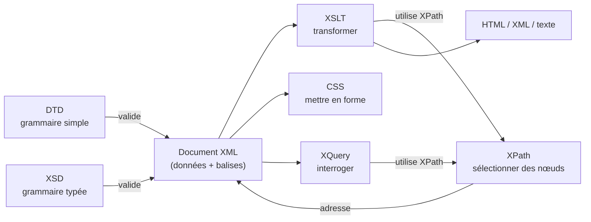

| Question | Outil |
|---|---|
| Comment écrire des données structurées ? | **XML** |
| Le document est-il *valide* ? | **DTD** ou **XSD** |
| Comment désigner une partie du document ? | **XPath** |
| Comment le transformer en HTML ou en autre XML ? | **XSLT** |
| Comment l'interroger comme une base de données ? | **XQuery** |
| Comment l'embellir dans un navigateur ? | **CSS** |

**Deux niveaux de correction :**

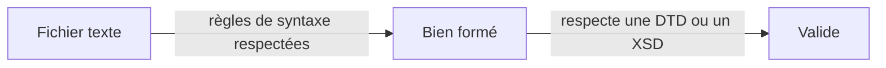

---

## 2. XML : structure et syntaxe

### 2.1 Exemple fil rouge (utilisé dans tout le guide)

```xml
<?xml version="1.0" encoding="UTF-8"?>
<!-- Description d'un annuaire -->
<annuaire type="pages blanches">
  <entree>
    <nom>Paul Lafargue</nom>
    <telephone>06 03 02 01 00</telephone>
  </entree>
  <entree>
    <nom><![CDATA[Lorédan Larchey]]></nom>
    <telephone>06 00 01 02 03</telephone>
  </entree>
</annuaire>
```

### 2.2 Anatomie

| Partie | Exemple | Signification |
|---|---|---|
| **Prologue** (entête) | `<?xml version="1.0" encoding="UTF-8"?>` | Version (1.0 ou 1.1), encodage (UTF-8 par défaut), `standalone` optionnel |
| **Racine** | `<annuaire>` | **Une seule** par document, juste après le prologue |
| **Élément / balise** | `<nom>Paul</nom>` | Balise par paire ; contenu entre les deux |
| **Élément vide** | `<br/>` | Balise auto-fermante |
| **Attribut** | `type="pages blanches"` | Information supplémentaire sur une balise |
| **CDATA** | `<![CDATA[ a < b & c ]]>` | Texte brut, sans échappement nécessaire |
| **Commentaire** | `<!-- ... -->` | Destiné aux humains |

### 2.3 Vue en arbre

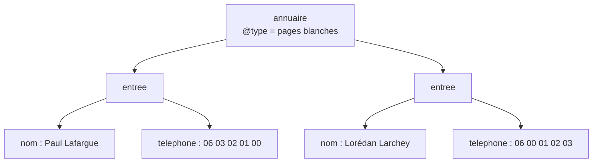

```
annuaire  (@type)
├── entree
│   ├── nom        → "Paul Lafargue"
│   └── telephone  → "06 03 02 01 00"
└── entree
    ├── nom        → "Lorédan Larchey"
    └── telephone  → "06 00 01 02 03"
```

### 2.4 Liste de contrôle : document bien formé

- Un seul élément racine
- Chaque balise ouvrante est fermée et les balises sont correctement imbriquées (`<a><b></b></a>`, jamais `<a><b></a></b>`)
- Les valeurs d'attributs sont entre guillemets
- Les noms d'attributs sont uniques dans une même balise
- Les noms sont sensibles à la casse
- Les caractères spéciaux sont échappés :

| Caractère | Échappement |
|---|---|
| `<` | `&lt;` |
| `>` | `&gt;` |
| `&` | `&amp;` |
| `"` | `&quot;` |
| `'` | `&apos;` |

```xml
<!-- FAUX -->   <note>5 < 6 & 7 > 3</note>
<!-- CORRECT --> <note>5 &lt; 6 &amp; 7 &gt; 3</note>
<!-- CORRECT --> <note><![CDATA[5 < 6 & 7 > 3]]></note>
```

---

## 3. DTD : Document Type Definition

Une DTD décrit : **la liste des balises**, **leurs attributs**, **leur organisation**. La *validation* vérifie qu'un fichier XML la respecte.

### 3.1 La DTD de notre annuaire

```dtd
<!ELEMENT annuaire (entree*)>
<!ATTLIST annuaire type CDATA "">
<!ELEMENT entree (nom, telephone*)>
<!ELEMENT nom (#PCDATA)>
<!ELEMENT telephone (#PCDATA)>
```

Lecture à voix haute :

- `annuaire` contient **zéro ou plusieurs** `entree`
- `annuaire` possède un attribut `type` (texte), vide par défaut
- `entree` contient un `nom` **puis** zéro ou plusieurs `telephone`
- `nom` et `telephone` ne contiennent que du texte

### 3.2 Déclarations d'éléments

| Type | DTD | XML |
|---|---|---|
| Vide | `<!ELEMENT elt EMPTY>` | `<elt/>` |
| Texte | `<!ELEMENT elt (#PCDATA)>` | `<elt>texte</elt>` |
| Enfants | `<!ELEMENT elt (a, b)>` | `<elt><a/><b/></elt>` |
| N'importe quoi | `<!ELEMENT elt ANY>` | contenu libre |

### 3.3 Opérateurs d'occurrence et de composition

| Symbole | Signification | Exemple |
|---|---|---|
| *(aucun)* | exactement 1 | `(nom)` |
| `?` | 0 ou 1 | `(nom?)` |
| `*` | 0 ou plus | `(entree*)` |
| `+` | 1 ou plus | `(entree+)` |
| `,` | séquence (ordonnée) | `(nom, telephone)` |
| `\|` | choix (l'un des deux) | `(email \| telephone)` |
| `( )` | regroupement | `((a, b)*)` |

**Test rapide :** lesquels sont valides pour `<!ELEMENT entree (nom, telephone*)>` ?

```xml
<entree><nom>A</nom></entree>                                   <!-- valide : 0 téléphone -->
<entree><nom>A</nom><telephone>1</telephone><telephone>2</telephone></entree>  <!-- valide -->
<entree><telephone>1</telephone><nom>A</nom></entree>           <!-- INVALIDE : mauvais ordre -->
<entree></entree>                                               <!-- INVALIDE : nom manquant -->
```

### 3.4 Attributs

```dtd
<!ATTLIST nom-element nom-attribut type contrainte "défaut">
```

```dtd
<!ATTLIST livre type (roman|essai|poesie) "roman">   <!-- énumération + valeur par défaut -->
<!ATTLIST ecrivain identifiant ID    #REQUIRED>       <!-- clé unique -->
<!ATTLIST auteur   identifiant IDREF #REQUIRED>       <!-- référence vers une clé -->
```

| Contrainte | Signification |
|---|---|
| `#REQUIRED` | l'attribut est obligatoire |
| `#IMPLIED` | l'attribut est optionnel |
| `#FIXED "v"` | la valeur est toujours `v` |

### 3.5 ID / IDREF = clé primaire / clé étrangère

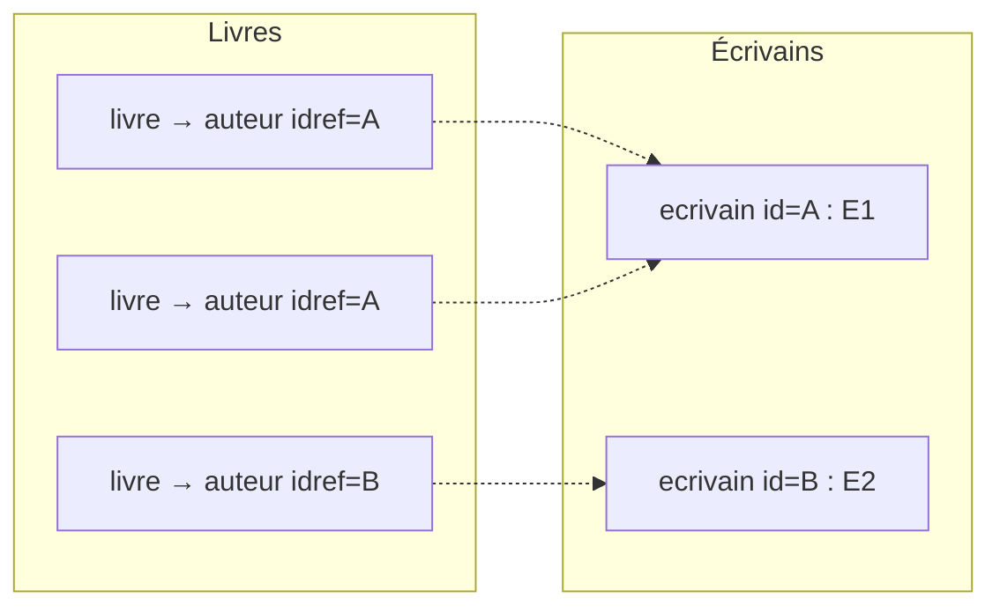

```dtd
<!ELEMENT bibliotheque (ecrivain*, livre*)>
<!ELEMENT ecrivain (#PCDATA)>
<!ELEMENT livre (auteur)>
<!ELEMENT auteur EMPTY>
<!ATTLIST ecrivain identifiant ID    #REQUIRED>
<!ATTLIST auteur   identifiant IDREF #REQUIRED>
```

```xml
<bibliotheque>
  <ecrivain identifiant="A">E1</ecrivain>
  <ecrivain identifiant="B">E2</ecrivain>
  <livre><auteur identifiant="A"/></livre>
  <livre><auteur identifiant="B"/></livre>
</bibliotheque>
```

> Remarque : une valeur d'`ID` doit commencer par une lettre ou un tiret bas (`A`, `id1`), pas par un chiffre seul.

### 3.6 Entités (alias)

| Sorte | Déclaration | Utilisation |
|---|---|---|
| Générale | `<!ENTITY nom "valeur">` | `<element>&nom;</element>` dans le XML |
| Paramètre | `<!ENTITY % types "(roman\|essai\|poesie)">` | `<!ATTLIST livre type %types; "">` dans la DTD |
| Externe | `<!ENTITY nom SYSTEM "URI">` | le contenu se trouve dans un autre fichier |

Quand on utilise des entités, `standalone` dans le prologue doit valoir `no`.

### 3.7 Rattacher une DTD à un fichier XML

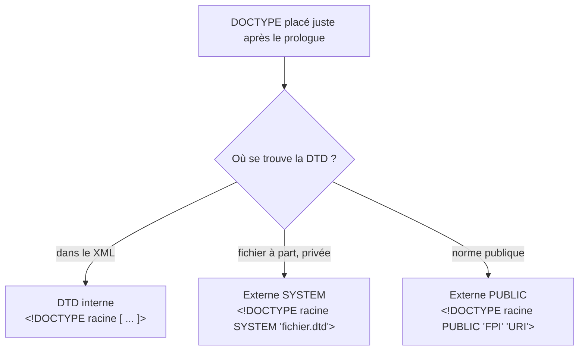

**DTD interne (exemple complet fonctionnel) :**

```xml
<?xml version="1.0" encoding="UTF-8" standalone="no"?>
<!DOCTYPE bibliotheque [
  <!ELEMENT ecrivain (#PCDATA)>
  <!ELEMENT bibliotheque (ecrivain*, livre*)>
  <!ELEMENT livre (auteur)>
  <!ELEMENT auteur EMPTY>
  <!ATTLIST livre type (roman|essai|poesie) "roman">
  <!ATTLIST ecrivain identifiant ID #REQUIRED>
  <!ATTLIST auteur   identifiant IDREF #REQUIRED>
]>
<bibliotheque>
  <ecrivain identifiant="A">E1</ecrivain>
  <livre type="roman"><auteur identifiant="A"/></livre>
</bibliotheque>
```

**Externe :**

```xml
<!DOCTYPE bibliotheque SYSTEM "bibliotheque.dtd">
<!DOCTYPE html PUBLIC "-//W3C//DTD XHTML 1.0 Strict//EN"
                      "http://www.w3.org/TR/xhtml1/DTD/xhtml1-strict.dtd">
```

Le nom qui suit `DOCTYPE` **doit être identique au nom de l'élément racine**.

### 3.8 Limites des DTD (pourquoi XSD existe)

- Pas de vrais types de données (tout est du texte)
- Pas écrite en syntaxe XML
- Support faible des espaces de noms
- Occurrences limitées à `? * +`

---

## 4. XSD : XML Schema Definition

Un XSD est un **document XML** qui décrit un autre document XML. Avantages par rapport à la DTD :

- Types de données riches (booléen, entier, date, durée, plus de 40 types prédéfinis)
- Création de nouveaux types à partir de types existants (restriction, extension, liste, union)
- Héritage entre types complexes
- Nombre d'occurrences quelconque (`minOccurs="5"`)
- Gestion des espaces de noms

### 4.1 Squelette

```xml
<?xml version="1.0" encoding="UTF-8"?>
<xsd:schema xmlns:xsd="http://www.w3.org/2001/XMLSchema"
            targetNamespace="http://www.example.org/bibliotheque"
            xmlns:tns="http://www.example.org/bibliotheque"
            elementFormDefault="qualified">

    <!-- les types et les éléments se placent ici -->

</xsd:schema>
```

| Attribut | Rôle |
|---|---|
| `xmlns:xsd` | Le vocabulaire W3C des schémas (préfixe `xsd:` ; `xs:` est aussi courant) |
| `targetNamespace` | Espace de noms de ce que ce XSD définit |
| `xmlns:tns` | Préfixe pour référencer nos propres types (« this namespace ») |
| `elementFormDefault="qualified"` | Les éléments du XML doivent porter le préfixe de l'espace de noms |

### 4.2 Le système de types

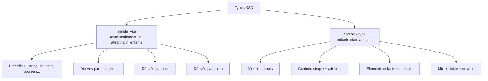

**Familles de types prédéfinis** (diapositive 34) :

```
string ── normalizedString ── token ── language, NMTOKEN, Name ── NCName ── ID, IDREF, ENTITY
decimal ── integer ── long ── int ── short ── byte
                         └── nonNegativeInteger ── positiveInteger, unsignedLong ── unsignedInt ...
dateTime, date, time, duration, gYear, gMonth, gDay ...
boolean, float, double, anyURI, QName, base64Binary, hexBinary
```

### 4.3 Types simples

**Restriction** (ajout de contraintes, appelées *facettes*) :

```xml
<!-- E-mail par expression régulière -->
<xsd:simpleType name="mailType">
  <xsd:restriction base="xsd:string">
    <xsd:pattern value="[a-zA-Z0-9._-]+@[a-zA-Z0-9-]+\.[a-zA-Z]{2,9}"/>
  </xsd:restriction>
</xsd:simpleType>

<!-- Âge entre 1 et 100 -->
<xsd:simpleType name="ageType">
  <xsd:restriction base="xsd:integer">
    <xsd:minInclusive value="1"/>
    <xsd:maxInclusive value="100"/>
  </xsd:restriction>
</xsd:simpleType>

<!-- Énumération -->
<xsd:simpleType name="sexeTypeChild">
  <xsd:restriction base="xsd:string">
    <xsd:enumeration value="homme"/>
    <xsd:enumeration value="femme"/>
    <xsd:enumeration value="indéterminé"/>
  </xsd:restriction>
</xsd:simpleType>
```

Facettes courantes : `length`, `minLength`, `maxLength`, `pattern`, `enumeration`, `minInclusive`, `maxInclusive`, `minExclusive`, `maxExclusive`, `totalDigits`, `fractionDigits`, `whiteSpace`.

**Liste** (valeurs séparées par des espaces) :

```xml
<xsd:simpleType name="listeInteger">
  <xsd:list itemType="xsd:integer"/>
</xsd:simpleType>
<!-- valeur valide : "3 14 15 92" -->
```

**Union** (la valeur peut appartenir à l'un des types listés) :

```xml
<xsd:simpleType name="union">
  <xsd:union memberTypes="xsd:string xsd:integer tns:mailType"/>
</xsd:simpleType>
```

### 4.4 Types complexes : quatre variantes

**a) Attributs seulement, pas de contenu**

```xml
<xsd:complexType name="AdresseOnlyAttributes">
  <xsd:attribute name="numero" type="xsd:int"/>
  <xsd:attribute name="rue"    type="xsd:string"/>
  <xsd:attribute name="ville"  type="xsd:string"/>
</xsd:complexType>
<!-- <adresse numero="5" rue="Main St" ville="Tunis"/> -->
```

**b) Contenu simple + attributs** (texte avec attributs)

```xml
<xsd:complexType name="Poids">
  <xsd:simpleContent>
    <xsd:extension base="xsd:integer">
      <xsd:attribute name="unite" type="xsd:string"/>
    </xsd:extension>
  </xsd:simpleContent>
</xsd:complexType>
<!-- <poids unite="kg">70</poids> -->
```

**c) Éléments enfants (+ attributs)**

```xml
<xsd:complexType name="person">
  <xsd:sequence>
    <xsd:element name="name"      type="xsd:string" minOccurs="5" maxOccurs="unbounded"/>
    <xsd:element name="firstName" type="xsd:string"/>
    <xsd:element name="old"       type="tns:ageType"/>
    <xsd:element name="email"     type="tns:mailType"/>
    <xsd:element name="sex"       type="tns:sexeTypeChild"/>
  </xsd:sequence>
  <xsd:attribute name="id" type="xsd:int"/>
</xsd:complexType>
```

**d) Contenu mixte** (texte et éléments ensemble)

```xml
<xsd:complexType name="lettreType" mixed="true">
  <xsd:sequence>
    <xsd:element name="salutation">
      <xsd:complexType mixed="true">
        <xsd:sequence><xsd:element name="nom" type="xsd:string"/></xsd:sequence>
      </xsd:complexType>
    </xsd:element>
  </xsd:sequence>
</xsd:complexType>
```

### 4.5 Indicateurs d'ordre

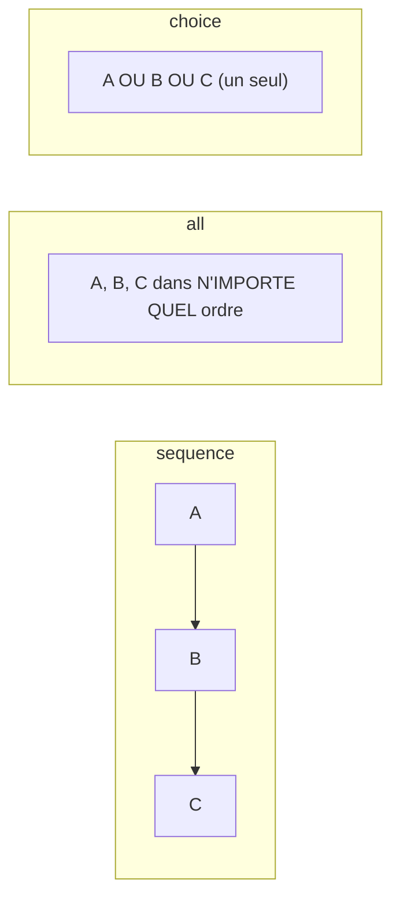

| Indicateur | Règle |
|---|---|
| `<xsd:sequence>` | enfants dans l'ordre déclaré |
| `<xsd:all>` | enfants dans n'importe quel ordre (chacun au plus une fois) |
| `<xsd:choice>` | exactement un des enfants |

### 4.6 Indicateurs d'occurrence

`minOccurs` (par défaut **1**) et `maxOccurs` (par défaut **1**). Utiliser `maxOccurs="unbounded"` pour l'infini. `minOccurs="0"` rend un élément optionnel.

### 4.7 Attributs en XSD

```xml
<xsd:attribute name="id"    type="xsd:int"   use="required"/>
<xsd:attribute name="lang"  type="xsd:string" use="optional" default="fr"/>
<xsd:attribute name="ver"   type="xsd:string" fixed="1.0"/>
<xsd:attribute name="old"   type="xsd:string" use="prohibited"/>
```

Un attribut ne peut avoir qu'un type **simple**. Il peut être défini globalement et réutilisé avec `ref` :

```xml
<xsd:attribute name="sexe">
  <xsd:simpleType>
    <xsd:restriction base="xsd:string">
      <xsd:enumeration value="F"/><xsd:enumeration value="M"/>
    </xsd:restriction>
  </xsd:simpleType>
</xsd:attribute>

<xsd:element name="employee">
  <xsd:complexType>
    <xsd:sequence>...</xsd:sequence>
    <xsd:attribute name="dateMAJ" type="xsd:dateTime"/>
    <xsd:attribute ref="tns:sexe"/>        <!-- réutilisation -->
  </xsd:complexType>
</xsd:element>
```

### 4.8 Éléments : deux styles de définition

```xml
<!-- 1) Type nommé, puis référence -->
<xsd:complexType name="TypePoids">...</xsd:complexType>
<xsd:element name="poids" type="tns:TypePoids"/>

<!-- 2) Type anonyme défini à l'intérieur de l'élément -->
<xsd:element name="employee">
  <xsd:complexType>
    <xsd:sequence>
      <xsd:element name="nom" type="xsd:string"/>
    </xsd:sequence>
  </xsd:complexType>
</xsd:element>
```

### 4.9 Dérivation : extension et restriction de types complexes

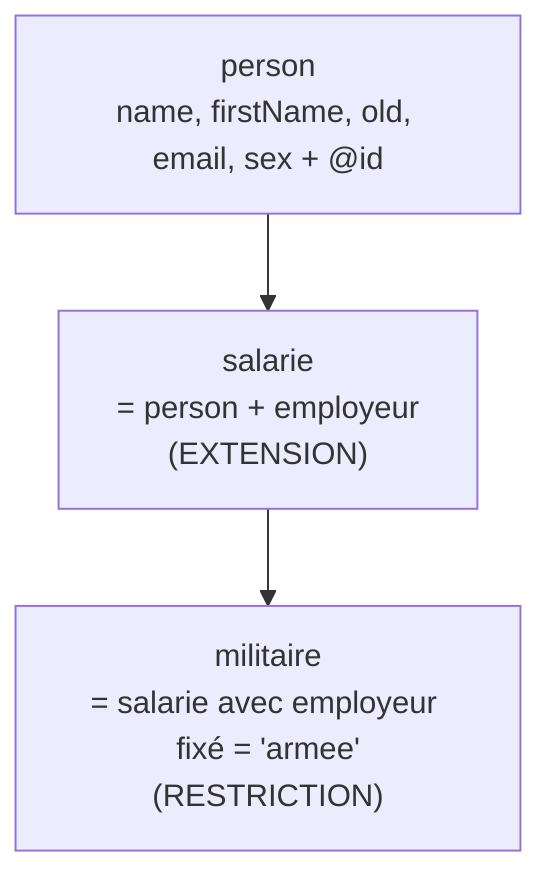

```xml
<xsd:complexType name="salarie">
  <xsd:complexContent>
    <xsd:extension base="tns:person">
      <xsd:sequence>
        <xsd:element name="employeur" type="xsd:string"/>
      </xsd:sequence>
    </xsd:extension>
  </xsd:complexContent>
</xsd:complexType>

<xsd:complexType name="militaire">
  <xsd:complexContent>
    <xsd:restriction base="tns:salarie">
      <xsd:sequence>
        <!-- il faut répéter tous les éléments de base, en les restreignant si besoin -->
        <xsd:element name="name" type="xsd:string" minOccurs="5" maxOccurs="unbounded"/>
        <xsd:element name="firstName" type="xsd:string"/>
        <xsd:element name="old" type="tns:ageType"/>
        <xsd:element name="email" type="tns:mailType"/>
        <xsd:element name="sex" type="tns:sexeTypeChild"/>
        <xsd:element name="employeur" type="xsd:string" fixed="armee"/>
      </xsd:sequence>
    </xsd:restriction>
  </xsd:complexContent>
</xsd:complexType>
```

- **extension** ajoute des éléments/attributs.
- **restriction** réduit ce qui est autorisé (et doit réénoncer le contenu de base).

### 4.10 Visibilité des types

Un type est visible par tous les descendants du nœud où il est déclaré.

- Déclaré sous `<schema>` (global) : utilisable partout.
- Déclaré à l'intérieur d'un autre élément (local/anonyme) : utilisable uniquement à cet endroit.

### 4.11 Annotations (commentaires pour les humains et les outils)

```xml
<xsd:annotation>
  <xsd:documentation>Type représentant un militaire</xsd:documentation>  <!-- pour les personnes -->
  <xsd:appinfo>...</xsd:appinfo>                                          <!-- pour les outils -->
</xsd:annotation>
```

### 4.12 Utiliser un XSD dans un document XML

```xml
<tns:lettre xmlns:tns="http://www.example.org/bibliotheque"
            xmlns:xsi="http://www.w3.org/2001/XMLSchema-instance"
            xsi:schemaLocation="http://www.example.org/bibliotheque bibliotheque.xsd">
  <tns:salutation>Cher <tns:nom>Frank</tns:nom></tns:salutation>
  <tns:facture>Votre facture numéro
     <tns:numero>ABS20131526</tns:numero> a bien été reçu à la date
     <tns:dateReception>2001-01-01</tns:dateReception>
  </tns:facture>
</tns:lettre>
```

| Élément | Rôle |
|---|---|
| `xmlns:xsi` | l'espace de noms W3C « instance » |
| `xmlns:tns` | notre espace de noms |
| `xsi:schemaLocation` | paires *(espace de noms, emplacement de son XSD)* |

Contrairement à une DTD, **n'importe quel élément global** du XSD peut servir de racine au document.

### 4.13 DTD vs XSD en un coup d'œil

| | DTD | XSD |
|---|---|---|
| Syntaxe | propre | XML |
| Types de données | texte seulement | plus de 40 types, types personnalisés |
| Occurrences | `? * +` | tout `minOccurs/maxOccurs` |
| Héritage | non | extension / restriction |
| Espaces de noms | faible | complet |
| Complexité | simple | verbeux, puissant |

---

## 5. Espaces de noms

Objectif : utiliser **plusieurs vocabulaires dans un même document** et supprimer **l'ambiguïté des noms** (deux grammaires qui définissent toutes deux un `<title>`).

```xml
<beans xmlns="http://www.springframework.org/schema/beans"
       xmlns:context="http://www.springframework.org/schema/context"
       xmlns:xsi="http://www.w3.org/2001/XMLSchema-instance"
       xsi:schemaLocation="
         http://www.springframework.org/schema/beans    spring-beans.xsd
         http://www.springframework.org/schema/context  spring-context.xsd">

  <bean id="mapper" class="org.dozer.Mapper"/>       <!-- espace de noms par défaut : beans -->
  <context:component-scan base-package="spring.com"/> <!-- avec préfixe : context -->
</beans>
```

Règles à retenir :

- `xmlns="URI"` définit l'espace de noms **par défaut** (sans préfixe).
- `xmlns:p="URI"` déclare le préfixe `p`.
- **L'URI est l'identité** ; le préfixe n'est qu'un surnom local.
- L'URI n'a pas besoin de pointer vers une vraie page web.

---

## 6. XPath

XPath est un standard W3C pour **identifier des nœuds ou des ensembles de nœuds** dans un arbre XML. C'est le fondement de XSLT et de XQuery.

### 6.1 Le modèle de données

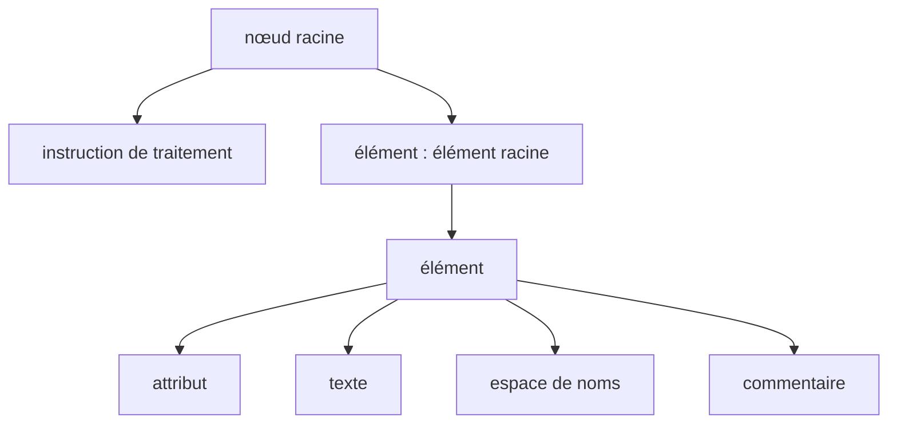

Types de nœuds : **racine, élément, attribut, texte, espace de noms, commentaire, instruction de traitement**.

### 6.2 Relations entre nœuds

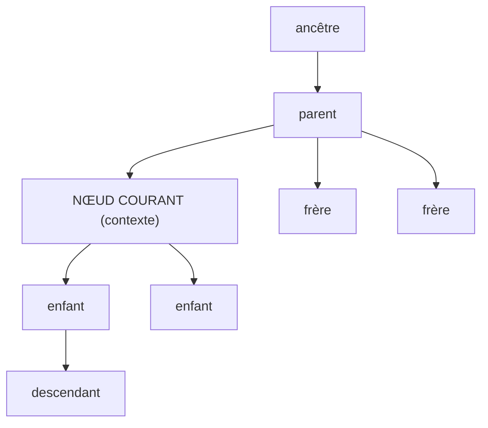

| Terme | Signification |
|---|---|
| parent | élément qui contient |
| enfants | éléments contenus |
| frères | même parent |
| ancêtres | parent, grand-parent, ... |
| descendants | enfants, petits-enfants, ... |

### 6.3 Syntaxe des chemins

Un chemin est une liste d'**étapes** séparées par `/`, comme une URL ou un chemin de fichier.

```
/annuaire/entree/nom
```

Chaque étape = **`axe :: test-de-nœud [prédicat]`**

```
child::entree[position()=1]
└─axe─┘└test─┘└─prédicat──┘
```

### 6.4 Syntaxe abrégée (celle qu'on écrit tous les jours)

| Abrégé | Équivalent long | Signification |
|---|---|---|
| `nom` | `child::nom` | élément enfant nommé nom |
| `/` (au début) | | depuis la racine |
| `//` | `/descendant-or-self::node()/` | n'importe où en dessous |
| `.` | `self::node()` | nœud courant |
| `..` | `parent::node()` | parent |
| `@type` | `attribute::type` | attribut |
| `*` | | n'importe quel élément |
| `[3]` | `[position()=3]` | 3e (**le comptage commence à 1**) |

### 6.5 Exemples sur l'annuaire

| Expression | Résultat |
|---|---|
| `/annuaire/entree/nom` | les deux éléments `nom` |
| `//nom` | tous les `nom`, où qu'ils soient |
| `/annuaire/@type` | `pages blanches` |
| `//entree[1]` | première entrée |
| `//entree[last()]` | dernière entrée |
| `//entree[2]/nom/text()` | `Lorédan Larchey` |
| `//entree[nom='Paul Lafargue']/telephone` | téléphone de Paul |
| `//nom[contains(., 'Paul')]` | noms contenant Paul |
| `count(//entree)` | `2` |
| `//entree[telephone]` | entrées qui ont un téléphone |
| `//entree/nom \| //entree/telephone` | union de deux ensembles |

### 6.6 Les 13 axes

```
                      ancestor::
                          ▲
                      parent::
                          ▲
 preceding-sibling:: ◄─ SELF ─► following-sibling::
                          │
                       child::
                          ▼
                    descendant::
```

| Axe | Sélectionne |
|---|---|
| `child` | enfants directs (axe par défaut) |
| `descendant` | enfants, petits-enfants, ... |
| `descendant-or-self` | descendants + le nœud lui-même |
| `parent` | le parent |
| `ancestor` | parent, grand-parent, ... |
| `ancestor-or-self` | ancêtres + lui-même |
| `following-sibling` | frères suivants |
| `preceding-sibling` | frères précédents |
| `following` | tout ce qui suit le nœud dans l'ordre du document (sauf descendants) |
| `preceding` | tout ce qui le précède (sauf ancêtres) |
| `attribute` | attributs |
| `namespace` | nœuds d'espace de noms |
| `self` | le nœud lui-même |

**Exemple détaillé** (diapositives 76-77) sur ce document :

```xml
<A>
  <B><C>sample</C><C>sample2</C></B>
  <B><C>sample</C><C>sample2</C><D>sample3</D></B>
</A>
```

| Expression | Résultat |
|---|---|
| `A/B[1]/following::*` | le 2e `B` et tout ce qu'il contient |
| `A/B[2]/preceding::*` | le 1er `B` et ses enfants |
| `A/B[1]/following::D` | le `<D>sample3</D>` |
| `A/descendant::*` | tous les éléments sous `A` |

### 6.7 Tests de nœud

| Test | Exemple | Sélectionne |
|---|---|---|
| test de nom | `child::nom` | éléments nommés `nom` |
| test de type de nœud | `text()`, `comment()`, `node()`, `processing-instruction()` | selon le type |
| test d'instruction de traitement | `processing-instruction('xml-stylesheet')` | cette instruction précise |

### 6.8 Prédicats et fonctions

```
//entree[position() = 2]
//entree[position() > 1 and position() < 5]
//para[@type = 'warning'][5]           (5e des para "warning", on filtre d'abord)
//para[5][@type = 'warning']           (5e para, puis on le garde s'il est warning)
child::*[self::chapter or self::appendix][position() = last()]
```

| Groupe | Fonctions |
|---|---|
| Ensemble de nœuds | `position()`, `last()`, `count()`, `id()` |
| Chaînes | `contains()`, `starts-with()`, `substring()`, `string-length()`, `concat()`, `normalize-space()` |
| Nombres | `sum()`, `round()`, `floor()`, `ceiling()` |
| Booléens | `not()`, `true()`, `false()` |

> `[@type='warning'][5]` et `[5][@type='warning']` sont **différents** : chaque prédicat filtre le résultat du précédent.

---

## 7. CSS sur XML

CSS peut mettre en forme des éléments XML **par leur nom** (on ne peut pas restructurer, seulement styliser). On le relie avec une instruction de traitement :

```xml
<?xml version="1.0" encoding="UTF-8"?>
<?xml-stylesheet type="text/css" href="style.css"?>
<annuaire>...</annuaire>
```

```css
annuaire  { display: block; font-family: Arial; }
entree    { display: block; margin: 8px; border-bottom: 1px solid #999; }
nom       { display: inline; font-weight: bold; }
nom:after { content: " : "; }
telephone { display: inline; color: darkblue; }
```

Important : les éléments XML n'ont pas de rendu par défaut, il faut donc définir soi-même `display: block/inline`.

---

## 8. XSLT

XSLT transforme une source XML en **un autre document** (HTML, XML, texte). La feuille de style est elle-même du XML.

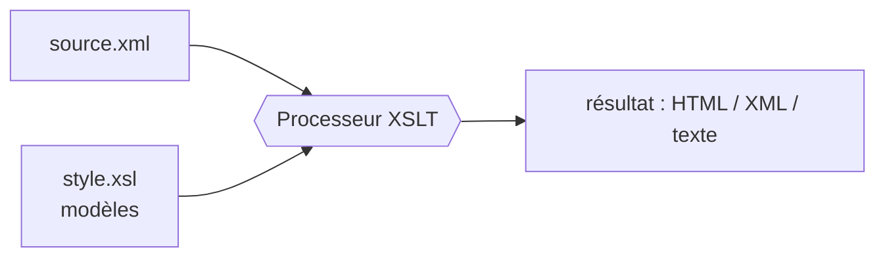

### 8.1 Modèle mental

1. Le processeur démarre à la **racine** de l'arbre source.
2. Il cherche un `<xsl:template match="...">` qui correspond au nœud courant.
3. Il exécute le corps de ce modèle. Les balises littérales sont copiées en sortie ; les instructions `xsl:` sont exécutées.
4. `<xsl:apply-templates/>` renvoie les enfants à l'étape 2.

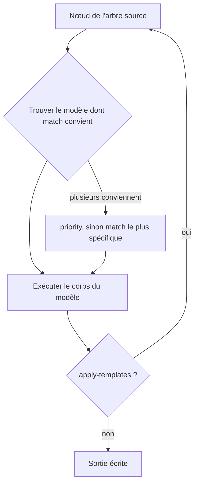

### 8.2 Exemple complet fonctionnel

**Entrée `nombres.xml` :**

```xml
<?xml version="1.0" encoding="UTF-8"?>
<liste_nombres>
  <nombre valeur="30">trente</nombre>
  <nombre valeur="4">quatre</nombre>
  <nombre valeur="12">douze</nombre>
</liste_nombres>
```

**Feuille de style `nombres.xsl` :**

```xml
<?xml version="1.0" encoding="UTF-8"?>
<xsl:stylesheet version="1.0"
    xmlns:xsl="http://www.w3.org/1999/XSL/Transform">

  <xsl:output method="html" encoding="utf-8" indent="yes"/>

  <!-- Modèle 1 : la liste racine -->
  <xsl:template match="liste_nombres">
    <html>
      <body>
        <p>Liste de nombres :</p>
        <ul>
          <xsl:for-each select="nombre">
            <xsl:sort select="@valeur" data-type="number"/>
            <xsl:apply-templates select="."/>
          </xsl:for-each>
        </ul>
      </body>
    </html>
  </xsl:template>

  <!-- Modèle 2 : un nombre -->
  <xsl:template match="nombre">
    <li>
      <xsl:value-of select="@valeur"/>
      <xsl:text> : </xsl:text>
      <xsl:value-of select="."/>
    </li>
  </xsl:template>
</xsl:stylesheet>
```

**Sortie :**

```html
<html><body>
  <p>Liste de nombres :</p>
  <ul>
    <li>4 : quatre</li>
    <li>12 : douze</li>
    <li>30 : trente</li>
  </ul>
</body></html>
```

Remarquez le tri numérique (4, 12, 30). Avec `data-type="text"`, on obtiendrait 12, 30, 4.

### 8.3 Structure

| Élément | Rôle |
|---|---|
| `<xsl:stylesheet version="1.0" xmlns:xsl="http://www.w3.org/1999/XSL/Transform">` | Racine (`<xsl:transform>` est un synonyme) |
| `<xsl:output method="html\|xml\|text" encoding indent doctype-public doctype-system>` | Format de sortie ; premier enfant de la racine |
| `<xsl:template match="XPath" name="" priority="">` | Une règle de transformation |

Attributs de `template` :

- `match` : XPath sélectionnant les nœuds auxquels la règle s'applique
- `name` : permet de l'appeler directement avec `<xsl:call-template name="..."/>`
- `priority` : départage plusieurs modèles qui correspondent

### 8.4 Boîte à outils des instructions

**Extraction et sortie**

| Instruction | Rôle | Exemple |
|---|---|---|
| `xsl:value-of` | insérer le texte d'un XPath | `<xsl:value-of select="@valeur"/>` |
| `xsl:text` | texte littéral (conserve les espaces) | `<xsl:text> : </xsl:text>` |
| `xsl:apply-templates` | traiter des nœuds via les modèles correspondants (sans `select` = tous les enfants) | `<xsl:apply-templates select="nombre"/>` |
| `xsl:call-template` | appeler un modèle nommé | `<xsl:call-template name="one"/>` |

**Logique**

```xml
<!-- Boucle -->
<xsl:for-each select="nombre"> ... </xsl:for-each>

<!-- If (pas de else !) -->
<xsl:if test="@valeur &gt; 10">
  <xsl:apply-templates select="."/>
</xsl:if>

<!-- Choose = if / else if / else -->
<xsl:choose>
  <xsl:when test="position() = 1"><xsl:call-template name="one"/></xsl:when>
  <xsl:when test="position() &gt; 1 and position() &lt; 3">
    <xsl:call-template name="gt1"/>
  </xsl:when>
  <xsl:otherwise><xsl:apply-templates select="."/></xsl:otherwise>
</xsl:choose>

<!-- Sort (enfant de for-each ou d'apply-templates) -->
<xsl:sort select="@valeur" data-type="number" order="descending" case-order="upper-first"/>
```

Dans `test="..."`, écrire `&lt;` et `&gt;` car la feuille de style est du XML.

**Générer du XML/HTML dynamiquement**

```xml
<xsl:copy/>                                      <!-- copie le nœud courant (pas ses enfants) -->
<xsl:element name="lien">
  <xsl:attribute name="href">http://example.org</xsl:attribute>
  Cliquez
</xsl:element>
<!-- produit : <lien href="http://example.org">Cliquez</lien> -->
```

### 8.5 Deuxième exemple complet : l'annuaire en tableau HTML

```xml
<xsl:stylesheet version="1.0" xmlns:xsl="http://www.w3.org/1999/XSL/Transform">
  <xsl:output method="html" indent="yes"/>

  <xsl:template match="/annuaire">
    <html>
      <body>
        <h1>Annuaire (<xsl:value-of select="@type"/>)</h1>
        <table border="1">
          <tr><th>Nom</th><th>Téléphone</th></tr>
          <xsl:apply-templates select="entree">
            <xsl:sort select="nom"/>
          </xsl:apply-templates>
        </table>
      </body>
    </html>
  </xsl:template>

  <xsl:template match="entree">
    <tr>
      <td><xsl:value-of select="nom"/></td>
      <td><xsl:value-of select="telephone"/></td>
    </tr>
  </xsl:template>
</xsl:stylesheet>
```

### 8.6 Templates vs for-each

| | `apply-templates` | `for-each` |
|---|---|---|
| Style | déclaratif, règles réutilisables | boucle procédurale |
| Réutilisation | un modèle peut servir à plusieurs endroits | logique écrite sur place |
| Idéal pour | documents structurés, récursifs | listes simples |

---

## 9. XQuery

XQuery est le **langage de requête pour XML** (comme SQL pour les tables). Il intègre XPath et ajoute les expressions **FLWOR**.

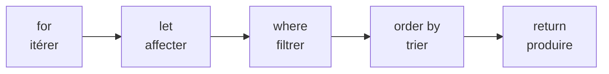

### 9.1 Requêtes de base sur l'annuaire

```xquery
(: tous les noms :)
for $e in doc("annuaire.xml")//entree
return $e/nom
```

```xquery
(: filtrer + trier + construire du nouveau XML :)
for $e in doc("annuaire.xml")//entree
where contains($e/nom, "Harry")
order by $e/nom ascending
return
  <contact>
    <n>{ $e/nom/text() }</n>
    <tel>{ $e/telephone/text() }</tel>
  </contact>
```

```xquery
(: conditionnelle :)
for $e in doc("annuaire.xml")//entree
return
  if ($e/nom = "Harry Cover")
  then $e/telephone
  else ()
```

```xquery
(: agrégats :)
let $all := doc("annuaire.xml")//entree
return <total>{ count($all) }</total>
```

### 9.2 Syntaxe à retenir

- Les variables commencent par `$`.
- `{ ... }` dans un élément construit signifie « évaluer cette expression ».
- Commentaires : `(: commentaire :)`.
- Les mots-clés sont en **minuscules** dans le standard.

### 9.3 Diapositives vs syntaxe standard (diapositive 107)

| Diapositive (ancien brouillon) | XQuery standard |
|---|---|
| `FOR $nom IN //nom` | `for $nom in //nom` |
| `RETURN` | `return` |
| `SORTBY(nom ASCENDING)` | `order by $nom ascending` |
| `AFTER //entree[1]` | `//entree[position() > 1]` |
| `IF ... THEN ... ELSE` | `if (...) then ... else ...` |
| `WHERE contains($entree/nom, "Harry")` | identique, `where` en minuscules |

### 9.4 XPath vs XSLT vs XQuery

| | XPath | XSLT | XQuery |
|---|---|---|---|
| But | sélectionner des nœuds | transformer des documents | interroger et construire des résultats |
| Syntaxe XML ? | non | oui | non |
| Style | expression | règles de modèles | expressions FLWOR |
| Usage typique | à l'intérieur des deux autres | XML → HTML | recherche / jointure / agrégation |

---

## 10. Aide-mémoire

### 10.1 Quelle technologie, quand ?

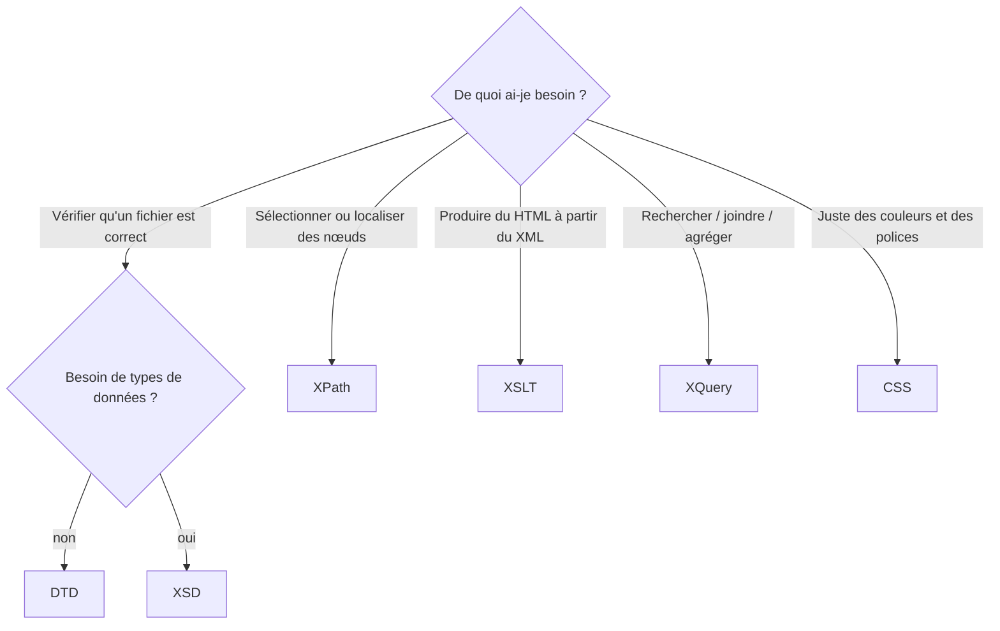

### 10.2 Comparaison de syntaxe pour une même idée : « un enfant texte obligatoire »

| Techno | Code |
|---|---|
| XML | `<nom>Paul</nom>` |
| DTD | `<!ELEMENT entree (nom)>` `<!ELEMENT nom (#PCDATA)>` |
| XSD | `<xsd:element name="nom" type="xsd:string"/>` |
| XPath | `/annuaire/entree/nom` |
| XSLT | `<xsl:value-of select="nom"/>` |
| XQuery | `for $e in //entree return $e/nom` |

### 10.3 Faits essentiels pour l'examen

- Racine : exactement **une**
- `standalone` par défaut : **no**
- L'indice XPath commence à **1**
- `minOccurs`/`maxOccurs` par défaut : **1**
- Types des attributs XSD : **simples uniquement**
- `simpleType` : ni enfants, ni attributs
- DTD : `,` = séquence, `|` = choix
- XSLT : `if` n'a **pas de else** (utiliser `choose`)
- Espace de noms XSLT : `http://www.w3.org/1999/XSL/Transform`
- Espace de noms XSD : `http://www.w3.org/2001/XMLSchema`
- `xsi:schemaLocation` = paires espace de noms + emplacement du XSD

---

## 11. Corrections des diapositives

Les diapositives contiennent quelques inexactitudes à connaître :

| Diapositive | Dit | En réalité |
|---|---|---|
| 7 | `standalone` vaut `yes` par défaut | Par défaut c'est **`no`** |
| 10 | Deux attributs d'une même balise peuvent porter le même nom | **Interdit** : le document n'est pas bien formé |
| 6 | `<!DOCTYPE livre ...>` sur un document `annuaire` | Le nom du DOCTYPE doit être égal à l'**élément racine** |
| 6 | `<! DOCTYPE` avec une espace | Il faut écrire `<!DOCTYPE` sans espace |
| 11 | « les caractères `> < &` ... doivent être remplacés par leur encodage HTML » | Ils sont remplacés par des **entités XML** (`&lt;` `&gt;` `&amp;`) ; `>` est techniquement permis mais l'échapper est une bonne pratique |
| 87 | « XLST » | Le nom correct est **XSLT** |
| 107 | `SORTBY`, `AFTER`, `FOR/IN/RETURN` en majuscules | Syntaxe d'un ancien brouillon ; utiliser le FLWOR standard |

---

## 12. Plan d'entraînement

**Niveau 1 : XML et DTD (30 min)**
1. Écrire `annuaire.xml` avec 3 entrées.
2. Écrire `annuaire.dtd` et ajouter `<!DOCTYPE annuaire SYSTEM "annuaire.dtd">`.
3. Le casser volontairement (échanger `nom` et `telephone`) et lire l'erreur.

**Niveau 2 : XSD (45 min)**
1. Écrire `annuaire.xsd` avec un `telephoneType` restreint par un `pattern` (`0[0-9]( [0-9]{2}){4}`).
2. Ajouter `use="required"` sur l'attribut `type`.
3. Valider : `xmllint --noout --schema annuaire.xsd annuaire.xml`

**Niveau 3 : XPath (45 min)**. Écrire des expressions pour :
- le téléphone de « Paul Lafargue »
- la dernière entrée
- chaque entrée dont le téléphone commence par `06 03`
- le nom de l'entrée *qui suit* Paul (utiliser `following-sibling`)

**Niveau 4 : XSLT (1 h)**
1. Produire un tableau HTML trié par nom.
2. Ajouter `xsl:if` pour mettre en évidence les numéros commençant par `06 03`.
3. Réécrire avec `xsl:choose` pour trois catégories de couleurs.

**Niveau 5 : XQuery (30 min)**
1. Réécrire les requêtes du niveau 3 en FLWOR.
2. Retourner des éléments `<contact><n>...</n></contact>` triés en ordre décroissant.

**Outils utiles :** `xmllint`, `xsltproc`, Saxon (XSLT et XQuery), VS Code avec l'extension XML, outils développeur du navigateur (`$x("//nom")` exécute du XPath dans la console).

```bash
xmllint --noout --dtdvalid annuaire.dtd annuaire.xml     # valider avec une DTD
xmllint --noout --schema annuaire.xsd annuaire.xml       # valider avec un XSD
xmllint --xpath "//entree[1]/nom" annuaire.xml           # exécuter du XPath
xsltproc annuaire.xsl annuaire.xml > annuaire.html       # exécuter du XSLT
```

---

*Fin du guide.*
