# XML Technologies: Complete Study Guide

> Summary of the course *02-Technologies_XML* (XML, DTD, XSD, Namespaces, XPath, CSS, XSLT, XQuery), focused on **code you can read, run and modify**.

---

## Table of Contents

1. [Big Picture](#1-big-picture)
2. [XML: Structure and Syntax](#2-xml-structure-and-syntax)
3. [DTD: Document Type Definition](#3-dtd-document-type-definition)
4. [XSD: XML Schema Definition](#4-xsd-xml-schema-definition)
5. [Namespaces](#5-namespaces)
6. [XPath](#6-xpath)
7. [CSS on XML](#7-css-on-xml)
8. [XSLT](#8-xslt)
9. [XQuery](#9-xquery)
10. [Cheat Sheets](#10-cheat-sheets)
11. [Corrections to the Slides](#11-corrections-to-the-slides)
12. [Practice Plan](#12-practice-plan)

---

## 1. Big Picture

XML **describes data** in a form both humans and machines can read. It stores *data + metadata* (the tags). Every other technology in the course works on the same XML file:

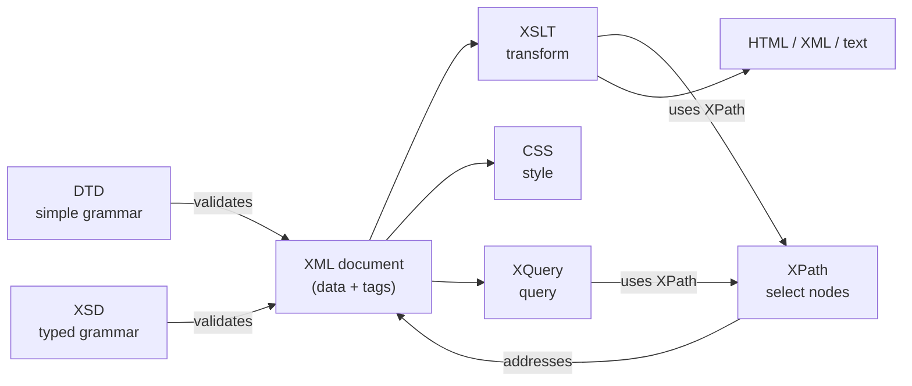

| Question | Tool |
|---|---|
| How do I write structured data? | **XML** |
| Is the document *valid*? | **DTD** or **XSD** |
| How do I point at part of it? | **XPath** |
| How do I turn it into HTML/other XML? | **XSLT** |
| How do I query it like a database? | **XQuery** |
| How do I make it look nice in a browser? | **CSS** |

**Two levels of correctness:**


---

## 2. XML: Structure and Syntax

### 2.1 Running example (used through the whole guide)

```xml
<?xml version="1.0" encoding="UTF-8"?>
<!-- Description of a phone book -->
<annuaire type="pages blanches">
  <entree>
    <nom>Paul Lafargue</nom>
    <telephone>06 03 02 01 00</telephone>
  </entree>
  <entree>
    <nom><![CDATA[Lorédan Larchey]]></nom>
    <telephone>06 00 01 02 03</telephone>
  </entree>
</annuaire>
```

### 2.2 Anatomy

| Part | Example | Meaning |
|---|---|---|
| **Prolog** (entête) | `<?xml version="1.0" encoding="UTF-8"?>` | Version (1.0 or 1.1), encoding (default UTF-8), optional `standalone` |
| **Root** (racine) | `<annuaire>` | Exactly **one** per document, right after the prolog |
| **Element / tag** (balise) | `<nom>Paul</nom>` | Paired tag; content between |
| **Empty element** | `<br/>` | Self-closing tag |
| **Attribute** | `type="pages blanches"` | Extra info on a tag |
| **CDATA** | `<![CDATA[ a < b & c ]]>` | Raw text, no escaping needed |
| **Comment** | `<!-- ... -->` | For humans |

### 2.3 The tree view

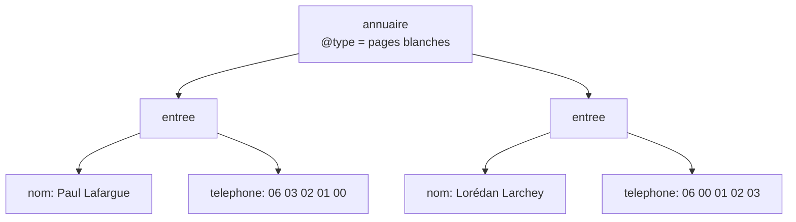

```
annuaire  (@type)
├── entree
│   ├── nom        → "Paul Lafargue"
│   └── telephone  → "06 03 02 01 00"
└── entree
    ├── nom        → "Lorédan Larchey"
    └── telephone  → "06 00 01 02 03"
```

### 2.4 Well-formedness checklist

- One root element only
- Every opening tag is closed, and tags are properly nested (`<a><b></b></a>`, never `<a><b></a></b>`)
- Attribute values are quoted
- Attribute names are unique inside one tag
- Names are case-sensitive
- Special characters escaped:

| Char | Escape |
|---|---|
| `<` | `&lt;` |
| `>` | `&gt;` |
| `&` | `&amp;` |
| `"` | `&quot;` |
| `'` | `&apos;` |

```xml
<!-- WRONG --> <note>5 < 6 & 7 > 3</note>
<!-- RIGHT --> <note>5 &lt; 6 &amp; 7 &gt; 3</note>
<!-- RIGHT --> <note><![CDATA[5 < 6 & 7 > 3]]></note>
```

---

## 3. DTD: Document Type Definition

A DTD describes: **the list of tags**, **their attributes**, **their organisation**. *Validation* checks that an XML file respects it.

### 3.1 The DTD of our annuaire

```dtd
<!ELEMENT annuaire (entree*)>
<!ATTLIST annuaire type CDATA "">
<!ELEMENT entree (nom, telephone*)>
<!ELEMENT nom (#PCDATA)>
<!ELEMENT telephone (#PCDATA)>
```

Reading it out loud:

- `annuaire` contains **zero or more** `entree`
- `annuaire` has an attribute `type` (text), default empty
- `entree` contains one `nom` **then** zero or more `telephone`
- `nom` and `telephone` contain only text

### 3.2 Element declarations

| Type | DTD | XML |
|---|---|---|
| Empty | `<!ELEMENT elt EMPTY>` | `<elt/>` |
| Text | `<!ELEMENT elt (#PCDATA)>` | `<elt>text</elt>` |
| Children | `<!ELEMENT elt (a, b)>` | `<elt><a/><b/></elt>` |
| Anything | `<!ELEMENT elt ANY>` | any content |

### 3.3 Occurrence and composition operators

| Symbol | Meaning | Example |
|---|---|---|
| *(none)* | exactly 1 | `(nom)` |
| `?` | 0 or 1 | `(nom?)` |
| `*` | 0 or more | `(entree*)` |
| `+` | 1 or more | `(entree+)` |
| `,` | sequence (ordered) | `(nom, telephone)` |
| `\|` | choice (one of) | `(email \| telephone)` |
| `( )` | grouping | `((a, b)*)` |

**Quick test:** which of these are valid for `<!ELEMENT entree (nom, telephone*)>`?

```xml
<entree><nom>A</nom></entree>                                   <!-- valid: 0 phones -->
<entree><nom>A</nom><telephone>1</telephone><telephone>2</telephone></entree>  <!-- valid -->
<entree><telephone>1</telephone><nom>A</nom></entree>           <!-- INVALID: wrong order -->
<entree></entree>                                               <!-- INVALID: nom missing -->
```

### 3.4 Attributes

```dtd
<!ATTLIST element-name attribute-name type constraint "default">
```

```dtd
<!ATTLIST livre type (roman|essai|poesie) "roman">   <!-- enumeration + default -->
<!ATTLIST ecrivain identifiant ID    #REQUIRED>       <!-- unique key -->
<!ATTLIST auteur   identifiant IDREF #REQUIRED>       <!-- reference to a key -->
```

| Constraint | Meaning |
|---|---|
| `#REQUIRED` | attribute is mandatory |
| `#IMPLIED` | attribute is optional |
| `#FIXED "v"` | value is always `v` |

### 3.5 ID / IDREF = primary key / foreign key

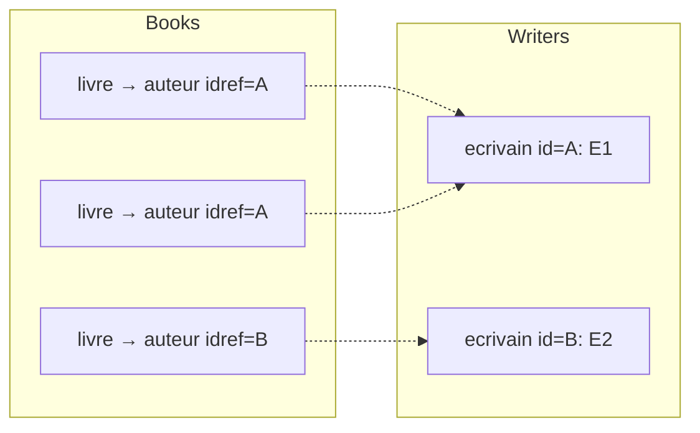

```dtd
<!ELEMENT bibliotheque (ecrivain*, livre*)>
<!ELEMENT ecrivain (#PCDATA)>
<!ELEMENT livre (auteur)>
<!ELEMENT auteur EMPTY>
<!ATTLIST ecrivain identifiant ID    #REQUIRED>
<!ATTLIST auteur   identifiant IDREF #REQUIRED>
```

```xml
<bibliotheque>
  <ecrivain identifiant="A">E1</ecrivain>
  <ecrivain identifiant="B">E2</ecrivain>
  <livre><auteur identifiant="A"/></livre>
  <livre><auteur identifiant="B"/></livre>
</bibliotheque>
```

> Note: an `ID` value must start with a letter or underscore (`A`, `id1`), not a digit alone.

### 3.6 Entities (aliases)

| Kind | Declaration | Use |
|---|---|---|
| General | `<!ENTITY nom "valeur">` | `<element>&nom;</element>` in XML |
| Parameter | `<!ENTITY % types "(roman\|essai\|poesie)">` | `<!ATTLIST livre type %types; "">` inside the DTD |
| External | `<!ENTITY nom SYSTEM "URI">` | content lives in another file |

When using entities, `standalone` in the prolog should be `no`.

### 3.7 Attaching a DTD to an XML file

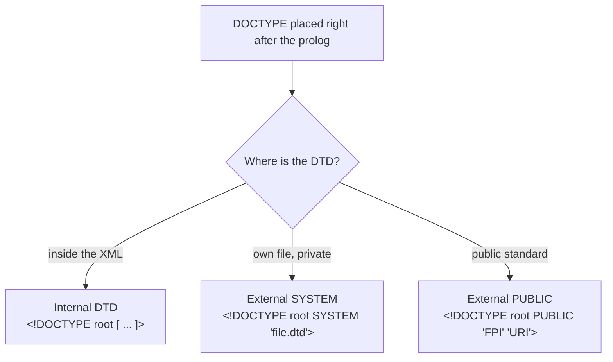

**Internal DTD (full working example):**

```xml
<?xml version="1.0" encoding="UTF-8" standalone="no"?>
<!DOCTYPE bibliotheque [
  <!ELEMENT ecrivain (#PCDATA)>
  <!ELEMENT bibliotheque (ecrivain*, livre*)>
  <!ELEMENT livre (auteur)>
  <!ELEMENT auteur EMPTY>
  <!ATTLIST livre type (roman|essai|poesie) "roman">
  <!ATTLIST ecrivain identifiant ID #REQUIRED>
  <!ATTLIST auteur   identifiant IDREF #REQUIRED>
]>
<bibliotheque>
  <ecrivain identifiant="A">E1</ecrivain>
  <livre type="roman"><auteur identifiant="A"/></livre>
</bibliotheque>
```

**External:**

```xml
<!DOCTYPE bibliotheque SYSTEM "bibliotheque.dtd">
<!DOCTYPE html PUBLIC "-//W3C//DTD XHTML 1.0 Strict//EN"
                      "http://www.w3.org/TR/xhtml1/DTD/xhtml1-strict.dtd">
```

The name after `DOCTYPE` **must equal the root element name**.

### 3.8 Limits of DTD (why XSD exists)

- No real data types (everything is text)
- Not written in XML syntax
- Weak namespace support
- Occurrences limited to `? * +`

---

## 4. XSD: XML Schema Definition

An XSD is an **XML document** that describes another XML document. Advantages over DTD:

- Rich data types (boolean, integer, date, duration, 40+ built-ins)
- Create new types from existing ones (restriction, extension, list, union)
- Inheritance between complex types
- Any occurrence count (`minOccurs="5"`)
- Namespace-aware

### 4.1 Skeleton

```xml
<?xml version="1.0" encoding="UTF-8"?>
<xsd:schema xmlns:xsd="http://www.w3.org/2001/XMLSchema"
            targetNamespace="http://www.example.org/bibliotheque"
            xmlns:tns="http://www.example.org/bibliotheque"
            elementFormDefault="qualified">

    <!-- types and elements go here -->

</xsd:schema>
```

| Attribute | Role |
|---|---|
| `xmlns:xsd` | The W3C schema vocabulary (`xsd:` prefix; `xs:` is also common) |
| `targetNamespace` | Namespace of the things this XSD defines |
| `xmlns:tns` | Prefix for referring to our own types ("this namespace") |
| `elementFormDefault="qualified"` | Elements in the XML must carry the namespace prefix |

### 4.2 The type system

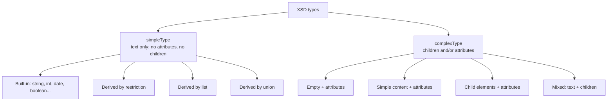

**Built-in type families** (slide 34):

```
string ── normalizedString ── token ── language, NMTOKEN, Name ── NCName ── ID, IDREF, ENTITY
decimal ── integer ── long ── int ── short ── byte
                         └── nonNegativeInteger ── positiveInteger, unsignedLong ── unsignedInt ...
dateTime, date, time, duration, gYear, gMonth, gDay ...
boolean, float, double, anyURI, QName, base64Binary, hexBinary
```

### 4.3 Simple types

**Restriction** (add constraints, called *facets*):

```xml
<!-- Email by regular expression -->
<xsd:simpleType name="mailType">
  <xsd:restriction base="xsd:string">
    <xsd:pattern value="[a-zA-Z0-9._-]+@[a-zA-Z0-9-]+\.[a-zA-Z]{2,9}"/>
  </xsd:restriction>
</xsd:simpleType>

<!-- Age between 1 and 100 -->
<xsd:simpleType name="ageType">
  <xsd:restriction base="xsd:integer">
    <xsd:minInclusive value="1"/>
    <xsd:maxInclusive value="100"/>
  </xsd:restriction>
</xsd:simpleType>

<!-- Enumeration -->
<xsd:simpleType name="sexeTypeChild">
  <xsd:restriction base="xsd:string">
    <xsd:enumeration value="homme"/>
    <xsd:enumeration value="femme"/>
    <xsd:enumeration value="indéterminé"/>
  </xsd:restriction>
</xsd:simpleType>
```

Common facets: `length`, `minLength`, `maxLength`, `pattern`, `enumeration`, `minInclusive`, `maxInclusive`, `minExclusive`, `maxExclusive`, `totalDigits`, `fractionDigits`, `whiteSpace`.

**List** (space-separated values):

```xml
<xsd:simpleType name="listeInteger">
  <xsd:list itemType="xsd:integer"/>
</xsd:simpleType>
<!-- valid value: "3 14 15 92" -->
```

**Union** (value may belong to any listed type):

```xml
<xsd:simpleType name="union">
  <xsd:union memberTypes="xsd:string xsd:integer tns:mailType"/>
</xsd:simpleType>
```

### 4.4 Complex types: four flavours

**a) Attributes only, no content**

```xml
<xsd:complexType name="AdresseOnlyAttributes">
  <xsd:attribute name="numero" type="xsd:int"/>
  <xsd:attribute name="rue"    type="xsd:string"/>
  <xsd:attribute name="ville"  type="xsd:string"/>
</xsd:complexType>
<!-- <adresse numero="5" rue="Main St" ville="Tunis"/> -->
```

**b) Simple content + attributes** (text with attributes)

```xml
<xsd:complexType name="Poids">
  <xsd:simpleContent>
    <xsd:extension base="xsd:integer">
      <xsd:attribute name="unite" type="xsd:string"/>
    </xsd:extension>
  </xsd:simpleContent>
</xsd:complexType>
<!-- <poids unite="kg">70</poids> -->
```

**c) Child elements (+ attributes)**

```xml
<xsd:complexType name="person">
  <xsd:sequence>
    <xsd:element name="name"      type="xsd:string" minOccurs="5" maxOccurs="unbounded"/>
    <xsd:element name="firstName" type="xsd:string"/>
    <xsd:element name="old"       type="tns:ageType"/>
    <xsd:element name="email"     type="tns:mailType"/>
    <xsd:element name="sex"       type="tns:sexeTypeChild"/>
  </xsd:sequence>
  <xsd:attribute name="id" type="xsd:int"/>
</xsd:complexType>
```

**d) Mixed content** (text and elements together)

```xml
<xsd:complexType name="lettreType" mixed="true">
  <xsd:sequence>
    <xsd:element name="salutation">
      <xsd:complexType mixed="true">
        <xsd:sequence><xsd:element name="nom" type="xsd:string"/></xsd:sequence>
      </xsd:complexType>
    </xsd:element>
  </xsd:sequence>
</xsd:complexType>
```

### 4.5 Order indicators

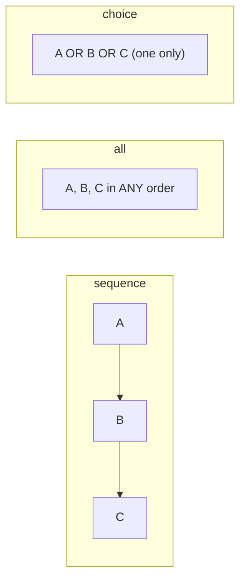

| Indicator | Rule |
|---|---|
| `<xsd:sequence>` | children in the declared order |
| `<xsd:all>` | children in any order (each at most once) |
| `<xsd:choice>` | exactly one of the children |

### 4.6 Occurrence indicators

`minOccurs` (default **1**) and `maxOccurs` (default **1**). Use `maxOccurs="unbounded"` for infinity. `minOccurs="0"` makes an element optional.

### 4.7 Attributes in XSD

```xml
<xsd:attribute name="id"    type="xsd:int"   use="required"/>
<xsd:attribute name="lang"  type="xsd:string" use="optional" default="fr"/>
<xsd:attribute name="ver"   type="xsd:string" fixed="1.0"/>
<xsd:attribute name="old"   type="xsd:string" use="prohibited"/>
```

An attribute can only have a **simple** type. It can be defined globally and reused with `ref`:

```xml
<xsd:attribute name="sexe">
  <xsd:simpleType>
    <xsd:restriction base="xsd:string">
      <xsd:enumeration value="F"/><xsd:enumeration value="M"/>
    </xsd:restriction>
  </xsd:simpleType>
</xsd:attribute>

<xsd:element name="employee">
  <xsd:complexType>
    <xsd:sequence>...</xsd:sequence>
    <xsd:attribute name="dateMAJ" type="xsd:dateTime"/>
    <xsd:attribute ref="tns:sexe"/>        <!-- reuse -->
  </xsd:complexType>
</xsd:element>
```

### 4.8 Elements: two definition styles

```xml
<!-- 1) Named type, then reference it -->
<xsd:complexType name="TypePoids">...</xsd:complexType>
<xsd:element name="poids" type="tns:TypePoids"/>

<!-- 2) Anonymous type defined inside the element -->
<xsd:element name="employee">
  <xsd:complexType>
    <xsd:sequence>
      <xsd:element name="nom" type="xsd:string"/>
    </xsd:sequence>
  </xsd:complexType>
</xsd:element>
```

### 4.9 Derivation: extension and restriction of complex types

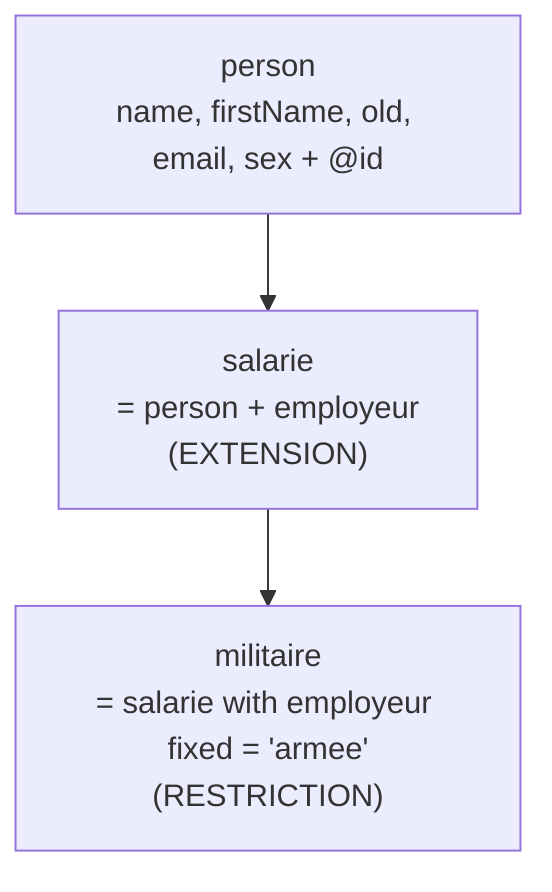

```xml
<xsd:complexType name="salarie">
  <xsd:complexContent>
    <xsd:extension base="tns:person">
      <xsd:sequence>
        <xsd:element name="employeur" type="xsd:string"/>
      </xsd:sequence>
    </xsd:extension>
  </xsd:complexContent>
</xsd:complexType>

<xsd:complexType name="militaire">
  <xsd:complexContent>
    <xsd:restriction base="tns:salarie">
      <xsd:sequence>
        <!-- must repeat all base elements, narrowing where needed -->
        <xsd:element name="name" type="xsd:string" minOccurs="5" maxOccurs="unbounded"/>
        <xsd:element name="firstName" type="xsd:string"/>
        <xsd:element name="old" type="tns:ageType"/>
        <xsd:element name="email" type="tns:mailType"/>
        <xsd:element name="sex" type="tns:sexeTypeChild"/>
        <xsd:element name="employeur" type="xsd:string" fixed="armee"/>
      </xsd:sequence>
    </xsd:restriction>
  </xsd:complexContent>
</xsd:complexType>
```

- **extension** adds elements/attributes.
- **restriction** narrows what is allowed (and must restate the base content).

### 4.10 Type visibility

A type is visible to all descendants of the node where it is declared.

- Declared under `<schema>` (global): usable everywhere.
- Declared inside another element (local/anonymous): usable only there.

### 4.11 Annotations (comments for humans and tools)

```xml
<xsd:annotation>
  <xsd:documentation>Type representing a soldier</xsd:documentation>  <!-- for people -->
  <xsd:appinfo>...</xsd:appinfo>                                       <!-- for tools -->
</xsd:annotation>
```

### 4.12 Using an XSD in an XML document

```xml
<tns:lettre xmlns:tns="http://www.example.org/bibliotheque"
            xmlns:xsi="http://www.w3.org/2001/XMLSchema-instance"
            xsi:schemaLocation="http://www.example.org/bibliotheque bibliotheque.xsd">
  <tns:salutation>Cher <tns:nom>Frank</tns:nom></tns:salutation>
  <tns:facture>Votre facture numéro
     <tns:numero>ABS20131526</tns:numero> a bien été reçu à la date
     <tns:dateReception>2001-01-01</tns:dateReception>
  </tns:facture>
</tns:lettre>
```

| Piece | Role |
|---|---|
| `xmlns:xsi` | the W3C "instance" namespace |
| `xmlns:tns` | our namespace |
| `xsi:schemaLocation` | pairs of *(namespace, file location of its XSD)* |

Unlike a DTD, **any global element** of the XSD may serve as the document root.

### 4.13 DTD vs XSD at a glance

| | DTD | XSD |
|---|---|---|
| Syntax | own syntax | XML |
| Data types | text only | 40+ types, custom types |
| Occurrences | `? * +` | any `minOccurs/maxOccurs` |
| Inheritance | no | extension / restriction |
| Namespaces | poor | full |
| Complexity | simple | verbose, powerful |

---

## 5. Namespaces

Purpose: use **several vocabularies in one document** and remove **name ambiguity** (two grammars both defining `<title>`).

```xml
<beans xmlns="http://www.springframework.org/schema/beans"
       xmlns:context="http://www.springframework.org/schema/context"
       xmlns:xsi="http://www.w3.org/2001/XMLSchema-instance"
       xsi:schemaLocation="
         http://www.springframework.org/schema/beans    spring-beans.xsd
         http://www.springframework.org/schema/context  spring-context.xsd">

  <bean id="mapper" class="org.dozer.Mapper"/>       <!-- default namespace: beans -->
  <context:component-scan base-package="spring.com"/> <!-- prefixed: context -->
</beans>
```

Rules of thumb:

- `xmlns="URI"` sets the **default** namespace (no prefix).
- `xmlns:p="URI"` declares prefix `p`.
- The **URI is the identity**; the prefix is just a local nickname.
- The URI does not have to point to a real web page.

---

## 6. XPath

XPath is a W3C standard to **identify nodes or sets of nodes** in an XML tree. It is the foundation of XSLT and XQuery.

### 6.1 The data model

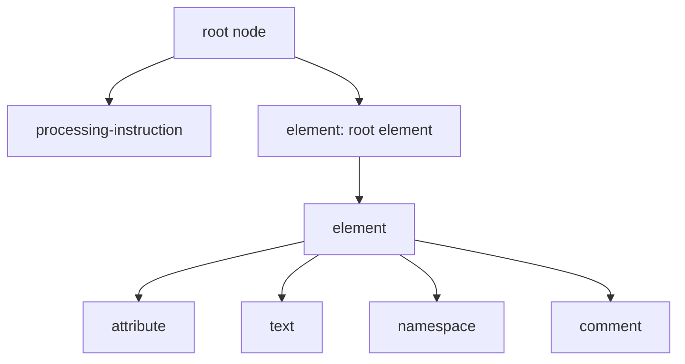

Node kinds: **root, element, attribute, text, namespace, comment, processing-instruction**.

### 6.2 Relations between nodes

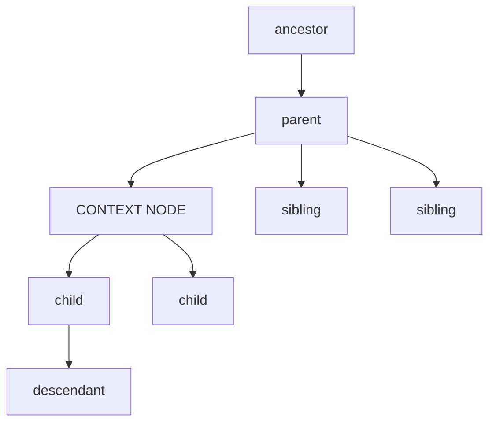

| Term | Meaning |
|---|---|
| parent | containing element |
| children | contained elements |
| siblings | same parent |
| ancestors | parent, grandparent, ... |
| descendants | children, grandchildren, ... |

### 6.3 Path syntax

A path is a list of **steps** separated by `/`, like a URL or file path.

```
/annuaire/entree/nom
```

Each step = **`axis :: node-test [predicate]`**

```
child::entree[position()=1]
└─axis─┘└test─┘└─predicate──┘
```

### 6.4 Abbreviated syntax (what you write daily)

| Short | Long equivalent | Meaning |
|---|---|---|
| `nom` | `child::nom` | child element named nom |
| `/` (start) | | from the root |
| `//` | `/descendant-or-self::node()/` | anywhere below |
| `.` | `self::node()` | current node |
| `..` | `parent::node()` | parent |
| `@type` | `attribute::type` | attribute |
| `*` | | any element |
| `[3]` | `[position()=3]` | 3rd (**counting starts at 1**) |

### 6.5 Examples on the annuaire

| Expression | Result |
|---|---|
| `/annuaire/entree/nom` | both `nom` elements |
| `//nom` | all `nom` anywhere |
| `/annuaire/@type` | `pages blanches` |
| `//entree[1]` | first entry |
| `//entree[last()]` | last entry |
| `//entree[2]/nom/text()` | `Lorédan Larchey` |
| `//entree[nom='Paul Lafargue']/telephone` | Paul's phone |
| `//nom[contains(., 'Paul')]` | names containing Paul |
| `count(//entree)` | `2` |
| `//entree[telephone]` | entries that have a phone |
| `//entree/nom \| //entree/telephone` | union of two sets |

### 6.6 The 13 axes

```
                      ancestor::
                          ▲
                      parent::
                          ▲
 preceding-sibling:: ◄─ SELF ─► following-sibling::
                          │
                       child::
                          ▼
                    descendant::
```

| Axis | Selects |
|---|---|
| `child` | direct children (default axis) |
| `descendant` | children, grandchildren, ... |
| `descendant-or-self` | descendants + the node itself |
| `parent` | the parent |
| `ancestor` | parent, grandparent, ... |
| `ancestor-or-self` | ancestors + itself |
| `following-sibling` | later siblings |
| `preceding-sibling` | earlier siblings |
| `following` | everything after the node in document order (not descendants) |
| `preceding` | everything before it (not ancestors) |
| `attribute` | attributes |
| `namespace` | namespace nodes |
| `self` | the node itself |

**Worked example** (slides 76-77) on this document:

```xml
<A>
  <B><C>sample</C><C>sample2</C></B>
  <B><C>sample</C><C>sample2</C><D>sample3</D></B>
</A>
```

| Expression | Result |
|---|---|
| `A/B[1]/following::*` | 2nd `B` and everything inside it |
| `A/B[2]/preceding::*` | 1st `B` and its children |
| `A/B[1]/following::D` | the `<D>sample3</D>` |
| `A/descendant::*` | every element under `A` |

### 6.7 Node tests

| Test | Example | Selects |
|---|---|---|
| name test | `child::nom` | elements named `nom` |
| node-type test | `text()`, `comment()`, `node()`, `processing-instruction()` | by kind |
| PI test | `processing-instruction('xml-stylesheet')` | that specific PI |

### 6.8 Predicates and functions

```
//entree[position() = 2]
//entree[position() > 1 and position() < 5]
//para[@type = 'warning'][5]           (5th of the "warning" paras, filter first)
//para[5][@type = 'warning']           (5th para, then keep it if warning)
child::*[self::chapter or self::appendix][position() = last()]
```

| Group | Functions |
|---|---|
| Node set | `position()`, `last()`, `count()`, `id()` |
| String | `contains()`, `starts-with()`, `substring()`, `string-length()`, `concat()`, `normalize-space()` |
| Number | `sum()`, `round()`, `floor()`, `ceiling()` |
| Boolean | `not()`, `true()`, `false()` |

> `[@type='warning'][5]` and `[5][@type='warning']` are **different**: each predicate filters the result of the previous one.

---

## 7. CSS on XML

CSS can format XML elements **by name** (you cannot restructure, only style). Link it with a processing instruction:

```xml
<?xml version="1.0" encoding="UTF-8"?>
<?xml-stylesheet type="text/css" href="style.css"?>
<annuaire>...</annuaire>
```

```css
annuaire  { display: block; font-family: Arial; }
entree    { display: block; margin: 8px; border-bottom: 1px solid #999; }
nom       { display: inline; font-weight: bold; }
nom:after { content: " : "; }
telephone { display: inline; color: darkblue; }
```

Important: XML elements have no default rendering, so set `display: block/inline` yourself.

---

## 8. XSLT

XSLT transforms an XML source into **another document** (HTML, XML, text). The stylesheet is itself XML.

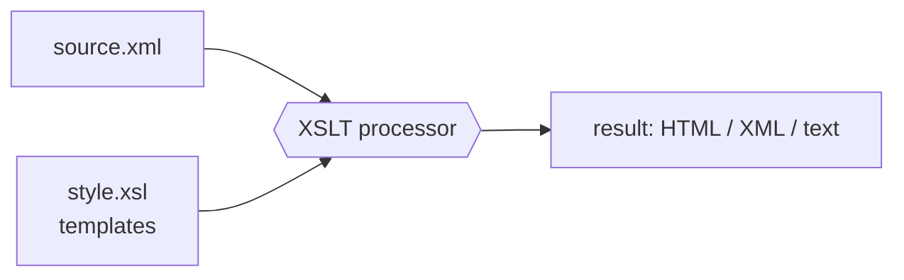

### 8.1 Mental model

1. The processor starts at the **root** of the source tree.
2. It looks for a `<xsl:template match="...">` matching the current node.
3. It runs that template's body. Literal tags are copied to output; `xsl:` instructions are executed.
4. `<xsl:apply-templates/>` sends the children back to step 2.

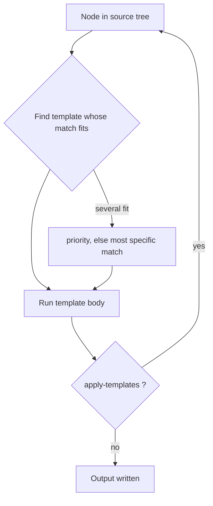

### 8.2 Complete working example

**Input `nombres.xml`:**

```xml
<?xml version="1.0" encoding="UTF-8"?>
<liste_nombres>
  <nombre valeur="30">trente</nombre>
  <nombre valeur="4">quatre</nombre>
  <nombre valeur="12">douze</nombre>
</liste_nombres>
```

**Stylesheet `nombres.xsl`:**

```xml
<?xml version="1.0" encoding="UTF-8"?>
<xsl:stylesheet version="1.0"
    xmlns:xsl="http://www.w3.org/1999/XSL/Transform">

  <xsl:output method="html" encoding="utf-8" indent="yes"/>

  <!-- Template 1: the root list -->
  <xsl:template match="liste_nombres">
    <html>
      <body>
        <p>Liste de nombres :</p>
        <ul>
          <xsl:for-each select="nombre">
            <xsl:sort select="@valeur" data-type="number"/>
            <xsl:apply-templates select="."/>
          </xsl:for-each>
        </ul>
      </body>
    </html>
  </xsl:template>

  <!-- Template 2: one number -->
  <xsl:template match="nombre">
    <li>
      <xsl:value-of select="@valeur"/>
      <xsl:text> : </xsl:text>
      <xsl:value-of select="."/>
    </li>
  </xsl:template>
</xsl:stylesheet>
```

**Output:**

```html
<html><body>
  <p>Liste de nombres :</p>
  <ul>
    <li>4 : quatre</li>
    <li>12 : douze</li>
    <li>30 : trente</li>
  </ul>
</body></html>
```

Note the numeric sort (4, 12, 30). With `data-type="text"` it would be 12, 30, 4.

### 8.3 Structure

| Element | Role |
|---|---|
| `<xsl:stylesheet version="1.0" xmlns:xsl="http://www.w3.org/1999/XSL/Transform">` | Root (`<xsl:transform>` is a synonym) |
| `<xsl:output method="html\|xml\|text" encoding indent doctype-public doctype-system>` | Output format; first child of the root |
| `<xsl:template match="XPath" name="" priority="">` | A transformation rule |

Template attributes:

- `match`: XPath selecting the nodes the rule applies to
- `name`: lets you call it directly with `<xsl:call-template name="..."/>`
- `priority`: tie-breaker when several templates match

### 8.4 Instruction toolbox

**Extraction and output**

| Instruction | Purpose | Example |
|---|---|---|
| `xsl:value-of` | insert text of an XPath | `<xsl:value-of select="@valeur"/>` |
| `xsl:text` | literal text (keeps spaces) | `<xsl:text> : </xsl:text>` |
| `xsl:apply-templates` | process nodes via matching templates (no `select` = all children) | `<xsl:apply-templates select="nombre"/>` |
| `xsl:call-template` | call a named template | `<xsl:call-template name="one"/>` |

**Logic**

```xml
<!-- Loop -->
<xsl:for-each select="nombre"> ... </xsl:for-each>

<!-- If (no else!) -->
<xsl:if test="@valeur &gt; 10">
  <xsl:apply-templates select="."/>
</xsl:if>

<!-- Choose = if / else if / else -->
<xsl:choose>
  <xsl:when test="position() = 1"><xsl:call-template name="one"/></xsl:when>
  <xsl:when test="position() &gt; 1 and position() &lt; 3">
    <xsl:call-template name="gt1"/>
  </xsl:when>
  <xsl:otherwise><xsl:apply-templates select="."/></xsl:otherwise>
</xsl:choose>

<!-- Sort (child of for-each or apply-templates) -->
<xsl:sort select="@valeur" data-type="number" order="descending" case-order="upper-first"/>
```

Inside `test="..."`, write `&lt;` and `&gt;` because the stylesheet is XML.

**Generating XML/HTML dynamically**

```xml
<xsl:copy/>                                      <!-- copy current node (not its children) -->
<xsl:element name="lien">
  <xsl:attribute name="href">http://example.org</xsl:attribute>
  Click
</xsl:element>
<!-- produces: <lien href="http://example.org">Click</lien> -->
```

### 8.5 Second full example: the annuaire as an HTML table

```xml
<xsl:stylesheet version="1.0" xmlns:xsl="http://www.w3.org/1999/XSL/Transform">
  <xsl:output method="html" indent="yes"/>

  <xsl:template match="/annuaire">
    <html>
      <body>
        <h1>Annuaire (<xsl:value-of select="@type"/>)</h1>
        <table border="1">
          <tr><th>Nom</th><th>Téléphone</th></tr>
          <xsl:apply-templates select="entree">
            <xsl:sort select="nom"/>
          </xsl:apply-templates>
        </table>
      </body>
    </html>
  </xsl:template>

  <xsl:template match="entree">
    <tr>
      <td><xsl:value-of select="nom"/></td>
      <td><xsl:value-of select="telephone"/></td>
    </tr>
  </xsl:template>
</xsl:stylesheet>
```

### 8.6 Templates vs for-each

| | `apply-templates` | `for-each` |
|---|---|---|
| Style | declarative, reusable rules | procedural loop |
| Reuse | template can serve many places | logic is inline |
| Best for | structured, recursive documents | simple lists |

---

## 9. XQuery

XQuery is the **query language for XML** (like SQL for tables). It embeds XPath and adds **FLWOR** expressions.

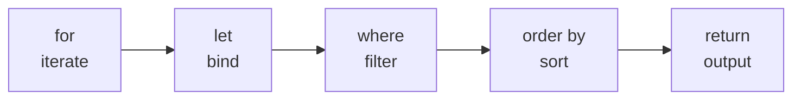

### 9.1 Basic queries on the annuaire

```xquery
(: all names :)
for $e in doc("annuaire.xml")//entree
return $e/nom
```

```xquery
(: filter + sort + build new XML :)
for $e in doc("annuaire.xml")//entree
where contains($e/nom, "Harry")
order by $e/nom ascending
return
  <contact>
    <n>{ $e/nom/text() }</n>
    <tel>{ $e/telephone/text() }</tel>
  </contact>
```

```xquery
(: conditional :)
for $e in doc("annuaire.xml")//entree
return
  if ($e/nom = "Harry Cover")
  then $e/telephone
  else ()
```

```xquery
(: aggregates :)
let $all := doc("annuaire.xml")//entree
return <total>{ count($all) }</total>
```

### 9.2 Syntax to remember

- Variables start with `$`.
- `{ ... }` inside a constructed element means "evaluate this expression".
- Comments: `(: comment :)`.
- Keywords are **lowercase** in the standard.

### 9.3 Slides vs standard syntax (slide 107)

| Slide (old draft) | Standard XQuery |
|---|---|
| `FOR $nom IN //nom` | `for $nom in //nom` |
| `RETURN` | `return` |
| `SORTBY(nom ASCENDING)` | `order by $nom ascending` |
| `AFTER //entree[1]` | `//entree[position() > 1]` |
| `IF ... THEN ... ELSE` | `if (...) then ... else ...` |
| `WHERE contains($entree/nom, "Harry")` | same, lowercase `where` |

### 9.4 XPath vs XSLT vs XQuery

| | XPath | XSLT | XQuery |
|---|---|---|---|
| Purpose | select nodes | transform documents | query and build results |
| Is XML syntax? | no | yes | no |
| Style | expression | template rules | FLWOR expressions |
| Typical use | inside the other two | XML → HTML | search / join / aggregate |

---

## 10. Cheat Sheets

### 10.1 Which technology, when?

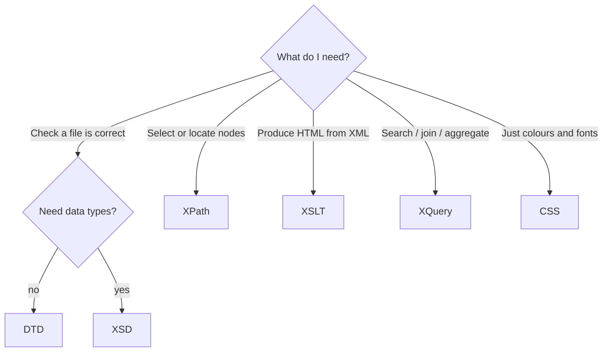

### 10.2 Syntax comparison for the same idea: "a required text child"

| Tech | Code |
|---|---|
| XML | `<nom>Paul</nom>` |
| DTD | `<!ELEMENT entree (nom)>` `<!ELEMENT nom (#PCDATA)>` |
| XSD | `<xsd:element name="nom" type="xsd:string"/>` |
| XPath | `/annuaire/entree/nom` |
| XSLT | `<xsl:value-of select="nom"/>` |
| XQuery | `for $e in //entree return $e/nom` |

### 10.3 Exam quick facts

- Root: exactly **one**
- `standalone` default: **no**
- XPath index starts at **1**
- `minOccurs`/`maxOccurs` default: **1**
- XSD attribute types: **simple only**
- `simpleType`: no children, no attributes
- DTD `,` = sequence, `|` = choice
- XSLT `if` has **no else** (use `choose`)
- XSLT namespace: `http://www.w3.org/1999/XSL/Transform`
- XSD namespace: `http://www.w3.org/2001/XMLSchema`
- `xsi:schemaLocation` = namespace + XSD location pairs

---

## 11. Corrections to the Slides

The slides contain a few inaccuracies worth knowing:

| Slide | Says | Reality |
|---|---|---|
| 7 | `standalone` defaults to `yes` | Default is **`no`** |
| 10 | Two attributes on a tag may share a name | **Not allowed**: not well-formed |
| 6 | `<!DOCTYPE livre ...>` on an `annuaire` document | DOCTYPE name must equal the **root element** |
| 6 | `<! DOCTYPE` with a space | Must be `<!DOCTYPE` with no space |
| 11 | "characters `> < &` ... must be replaced by HTML encoding" | They are replaced by **XML entities** (`&lt;` `&gt;` `&amp;`); `>` is technically allowed but escaping is good practice |
| 87 | "XLST" | The name is **XSLT** |
| 107 | `SORTBY`, `AFTER`, uppercase `FOR/IN/RETURN` | Old draft syntax; use standard FLWOR |

---

## 12. Practice Plan

**Level 1: XML and DTD (30 min)**
1. Write `annuaire.xml` with 3 entries.
2. Write `annuaire.dtd` and add `<!DOCTYPE annuaire SYSTEM "annuaire.dtd">`.
3. Break it on purpose (swap `nom` and `telephone`) and read the error.

**Level 2: XSD (45 min)**
1. Write `annuaire.xsd` with a `telephoneType` restricted by a `pattern` (`0[0-9]( [0-9]{2}){4}`).
2. Add `use="required"` on the `type` attribute.
3. Validate: `xmllint --noout --schema annuaire.xsd annuaire.xml`

**Level 3: XPath (45 min)**. Write expressions for:
- the phone of "Paul Lafargue"
- the last entry
- every entry whose phone starts with `06 03`
- the name of the entry *following* Paul (use `following-sibling`)

**Level 4: XSLT (1 h)**
1. Produce an HTML table sorted by name.
2. Add `xsl:if` to highlight numbers starting with `06 03`.
3. Rewrite with `xsl:choose` for three colour categories.

**Level 5: XQuery (30 min)**
1. Rewrite the level 3 queries in FLWOR.
2. Return `<contact><n>...</n></contact>` elements sorted descending.

**Useful tools:** `xmllint`, `xsltproc`, Saxon (XSLT and XQuery), VS Code with XML extension, browser dev tools (`$x("//nom")` runs XPath in the console).

```bash
xmllint --noout --dtdvalid annuaire.dtd annuaire.xml     # validate with DTD
xmllint --noout --schema annuaire.xsd annuaire.xml       # validate with XSD
xmllint --xpath "//entree[1]/nom" annuaire.xml           # run XPath
xsltproc annuaire.xsl annuaire.xml > annuaire.html       # run XSLT
```

---

*End of guide.*
